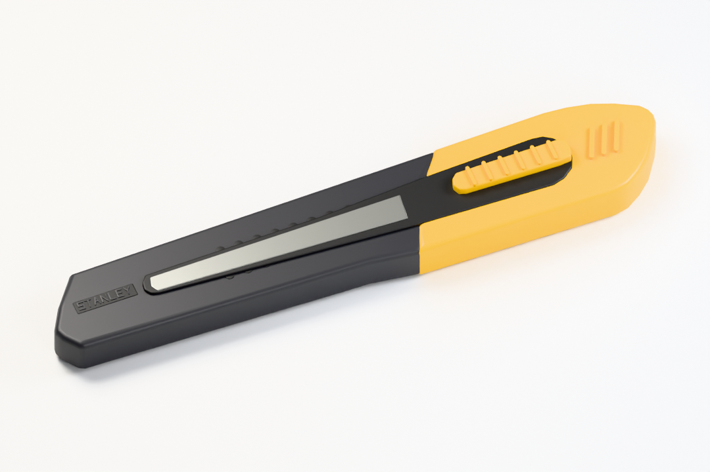
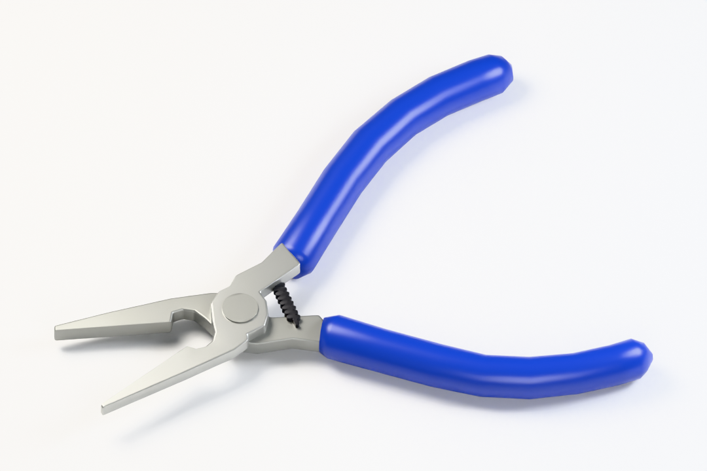
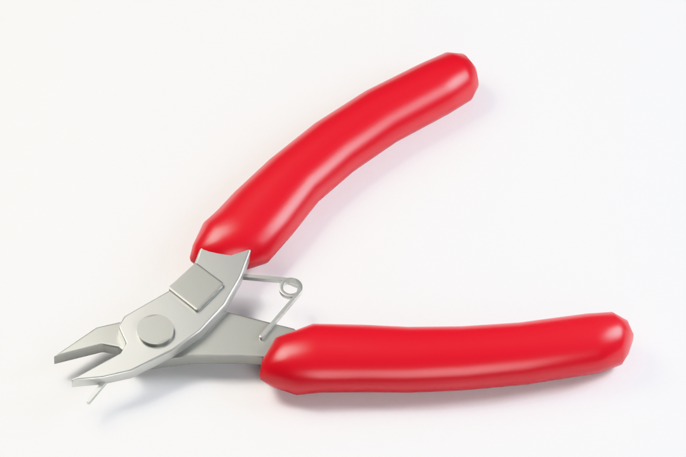
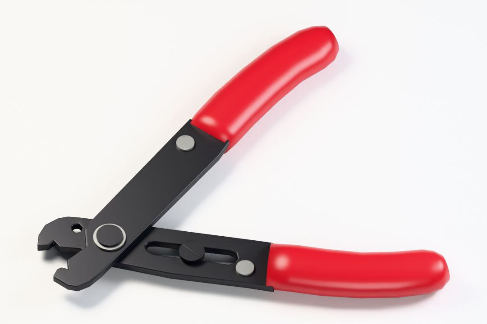

<!-- oomp-tools:start -->
# OOMP tool catalogue

Workshop tools and stationery used by OOBB part holder v5. Each part page includes a dimension drawing, editable OpenSCAD, exchange models and the layouts that use it.

[Build and edit the catalogue](BUILD.md) · [Source files](source_file/tool_references/)

## Blender renders

| [Black Exacto-style craft knife, 17 mm](parts/tool_knife_craft_17_mm_black_exacto_style/README.md) | [Blue needle-nose pliers, 130 mm](parts/tool_pliers_needle_nose_130_mm_length_blue/README.md) |
| --- | --- |
|  |  |

| [Red side cutters, 110 mm](parts/tool_side_cutters_110_mm_length_red/README.md) | [Red wire strippers, 120 mm](parts/tool_wire_strippers_120_mm_length_red/README.md) |
| --- | --- |
|  |  |

[Photographs, dimensions and modelling notes](parts/PHOTO_MODELS.md)

## Tools in their holders

The illustrated booklets show how the two printed halves meet on the wall and how each tool drops into the top opening.

- [Black Exacto-style craft knife, 17 mm holder README](https://github.com/oomlout/oomlout_oobb_part_holder_tool_version_5/blob/main/parts/oobb_part_holder_tool_knife_exacto_17mm_1_place_3x5x29d5/README.md#assembly) · [Print booklet (PDF)](source_file/tool_references/holders/oobb_part_holder_tool_knife_exacto_17mm_1_place_3x5x29d5.pdf)
- [Blue needle-nose pliers, 130 mm holder README](https://github.com/oomlout/oomlout_oobb_part_holder_tool_version_5/blob/main/parts/oobb_part_holder_tool_pliers_needle_nose_130mm_1_place_5x5x12/README.md#assembly) · [Print booklet (PDF)](source_file/tool_references/holders/oobb_part_holder_tool_pliers_needle_nose_130mm_1_place_5x5x12.pdf)
- [Red side cutters, 110 mm holder README](https://github.com/oomlout/oomlout_oobb_part_holder_tool_version_5/blob/main/parts/oobb_part_holder_tool_side_cutters_generic_110mm_1_place_5x5x13/README.md#assembly) · [Print booklet (PDF)](source_file/tool_references/holders/oobb_part_holder_tool_side_cutters_generic_110mm_1_place_5x5x13.pdf)
- [Red wire strippers, 120 mm holder README](https://github.com/oomlout/oomlout_oobb_part_holder_tool_version_5/blob/main/parts/oobb_part_holder_tool_wire_strippers_generic_120mm_1_place_5x5x13/README.md#assembly) · [Print booklet (PDF)](source_file/tool_references/holders/oobb_part_holder_tool_wire_strippers_generic_120mm_1_place_5x5x13.pdf)

## Catalogue

37 tool records cover 61 holder layouts. Browse by [OOMP taxonomy](navigation_oomp/README.md) or [holder layout](HOLDERS.md).

| Tool | Geometry |
| --- | --- |
| [Sharpie-style felt-tip pen, 13 × 137 mm](parts/stationery_felt_tip_pen_13_mm_diameter_137_mm_length_sharpie_style/README.md) | External tool reference |
| [BIC clear-lid marker](parts/stationery_felt_tip_pen_clear_lid_bic/README.md) | Holder clearance profile |
| [Large German marker](parts/stationery_felt_tip_pen_large_german_style/README.md) | Holder clearance profile |
| [IKEA MÅLA marker](parts/stationery_felt_tip_pen_mala_ikea/README.md) | Holder clearance profile |
| [Sharpie standard-tip marker, 13 × 137 mm](parts/stationery_felt_tip_pen_sharpie_standard_tip_style_13_mm_diameter_137_mm_length_sharpie/README.md) | External tool reference |
| [Thick patterned marker](parts/stationery_felt_tip_pen_thick_patterned/README.md) | Holder clearance profile |
| [Medium Prit glue stick](parts/stationery_glue_stick_medium_prit_style/README.md) | Holder clearance profile |
| [TDPB M3 drill cleaner](parts/tool_drill_cleaner_m3_tdpb/README.md) | Holder clearance profile |
| [TDPB M6 drill cleaner](parts/tool_drill_cleaner_m6_tdpb/README.md) | Holder clearance profile |
| [1.5 mm metric hex key](parts/tool_hex_key_1_5_mm/README.md) | External tool reference |
| [2.5 mm metric hex key](parts/tool_hex_key_2_5_mm/README.md) | External tool reference |
| [2 mm metric hex key](parts/tool_hex_key_2_mm/README.md) | External tool reference |
| [3 mm metric hex key](parts/tool_hex_key_3_mm/README.md) | External tool reference |
| [4 mm metric hex key](parts/tool_hex_key_4_mm/README.md) | External tool reference |
| [5 mm metric hex key](parts/tool_hex_key_5_mm/README.md) | External tool reference |
| [Black Exacto-style craft knife, 17 mm](parts/tool_knife_craft_17_mm_black_exacto_style/README.md) | Photo-based tool model |
| [Utility knife, 17 mm blade](parts/tool_knife_utility_17_mm_blade/README.md) | Holder clearance profile |
| [OLFA DC-3 blade disposal can](parts/tool_knife_utility_blade_disposal_can_olfa_dc_3/README.md) | External tool reference |
| [Mitutoyo 500-196-30 digital caliper, 150 mm](parts/tool_measure_caliper_digital_150_mm_length_mitutoyo_mit500_196_30/README.md) | External tool reference |
| [Stanley 1-30-696 tape measure, 5 m](parts/tool_measure_tape_measure_5000_mm_length_stanley_1_30_696/README.md) | Holder clearance profile |
| [TDPB nozzle changer](parts/tool_nozzle_changer_tdpb/README.md) | Holder clearance profile |
| [Blue needle-nose pliers, 130 mm](parts/tool_pliers_needle_nose_130_mm_length_blue/README.md) | Photo-based tool model |
| [Quikpik multi-driver, 200 mm](parts/tool_screw_driver_multi_driver_200_mm_quikpik/README.md) | Holder clearance profile |
| [Picquic Teeny Turner precision multi-driver](parts/tool_screw_driver_multi_driver_precision_size_teeny_turner_model_picquic/README.md) | External tool reference |
| [Wera 2054 Micro hex screwdriver, 1.5 × 60 mm](parts/tool_screw_driver_precision_kraftform_micro_style_18_mm_diameter_157_mm_depth_hex_head_1_5_mm_wera_2054_series_05118066001/README.md) | External tool reference |
| [Wera 2054 Micro hex screwdriver, 2.5 × 60 mm](parts/tool_screw_driver_precision_kraftform_micro_style_18_mm_diameter_157_mm_depth_hex_head_2_5_mm_wera_2054_series_05118070001/README.md) | External tool reference |
| [Wera 2054 Micro hex screwdriver, 2 × 60 mm](parts/tool_screw_driver_precision_kraftform_micro_style_18_mm_diameter_157_mm_depth_hex_head_2_mm_wera_2054_series_05118068001/README.md) | External tool reference |
| [Driver bit, 60 mm profile](parts/tool_screwdriver_bit_60_mm_profile/README.md) | Holder clearance profile |
| [Quarter-inch drive bit](parts/tool_screwdriver_bit_quarter_inch_drive/README.md) | Holder clearance profile |
| [Red side cutters, 110 mm](parts/tool_side_cutters_110_mm_length_red/README.md) | Photo-based tool model |
| [Round black timer, 80 × 30 mm](parts/tool_timer_80_mm_diameter_30_mm_depth_black/README.md) | External tool reference |
| [Red wire strippers, 120 mm](parts/tool_wire_strippers_120_mm_length_red/README.md) | Photo-based tool model |
| [M10 wrench](parts/tool_wrench_m10/README.md) | Holder clearance profile |
| [M13 wrench](parts/tool_wrench_m13/README.md) | Holder clearance profile |
| [M21 wrench](parts/tool_wrench_m21/README.md) | Holder clearance profile |
| [M7 wrench](parts/tool_wrench_m7/README.md) | Holder clearance profile |
| [M8 wrench](parts/tool_wrench_m8/README.md) | Holder clearance profile |
<!-- oomp-tools:end -->
