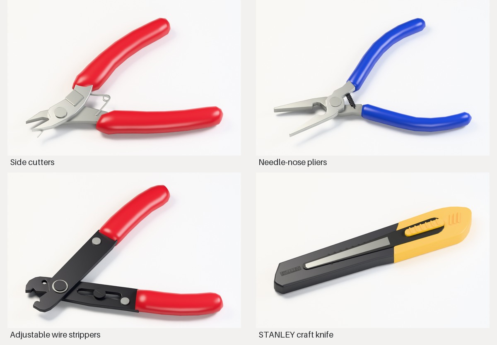

# Four workshop tools from photographs

The four original close-ups are in the individual part folders with their camera filenames. Each measurements page links to the photograph and a CAD silhouette superimposed on it. The yellow dashed line in the overlay shows precisely which landmarks set the scale.

| Tool and measurements | Scale reference | Approximate CAD envelope in the pictured pose, length × width × thickness | Views |
| --- | --- | --- | --- |
| [Side cutters](tool_side_cutters_110_mm_length_red/measurements.md) | 110 mm, Rapid SA-706 RED candidate | 103.7 × 78.8 × 10.0 mm | [Studio](tool_side_cutters_110_mm_length_red/three_d_model/render.png) · [Top](tool_side_cutters_110_mm_length_red/three_d_model/render_top.png) |
| [Needle-nose pliers](tool_pliers_needle_nose_130_mm_length_blue/measurements.md) | 130 mm, Rapid PC-022 candidate | 118.7 × 91.3 × 9.5 mm | [Studio](tool_pliers_needle_nose_130_mm_length_blue/three_d_model/render.png) · [Top](tool_pliers_needle_nose_130_mm_length_blue/three_d_model/render_top.png) |
| [Adjustable wire strippers](tool_wire_strippers_120_mm_length_red/measurements.md) | 130 mm, Anvil AV-LDWS candidate | 117.7 × 109.0 × 11.0 mm | [Studio](tool_wire_strippers_120_mm_length_red/three_d_model/render.png) · [Top](tool_wire_strippers_120_mm_length_red/three_d_model/render_top.png) |
| [STANLEY craft knife](tool_knife_craft_17_mm_black_exacto_style/measurements.md) | 165 mm, 0-10-151 candidate | 164.8 × 30.0 × 15.0 mm | [Studio](tool_knife_craft_17_mm_black_exacto_style/three_d_model/render.png) · [Top](tool_knife_craft_17_mm_black_exacto_style/three_d_model/render_top.png) |

The photos establish proportions, colours and poses. Each has its own provisional scale. The cutter, pliers and stripper lengths use a two-segment path through the pivot to approximate the overall length with the jaws closed. The knife uses a nose-to-heel path. Camera angle, perspective and the choice of landmarks carry through to all planar dimensions. The thicknesses are modelling inputs. The knife's fresh photo confirms STANLEY on the moulding. Its exact variant and the stripper's 120 versus 130 mm size are still open. [Original identification and catalogue sources](TOOL_IDENTIFICATION_2026-11-19.md)

## How to repeat the build

1. Put the original photograph in the part folder. Choose visible scale landmarks and a longitudinal axis. Record the photo filename, scale length, scale path and axis in the tool declaration. The traces for this set use original image coordinates divided by eight, with the origin in the top-left. This permits inspection on a small screen while preserving registration to the original. [Tool declarations](../working_tool_declarations.py)
2. Trace each visible piece. For a grip, record several centre points and widths measured perpendicular to the grip, including the sleeve opening, bend and rounded end. The builder joins elliptical sections at those stations. For the steel arms, follow the visible edge and give each arm its own height above the table. The pivot joins them. Keep the adjustment slot and pierced jaw as holes so they also appear in the STL. The knife uses a closed housing and fixed exterior details. [Editable shape recipes](../working_photo_tools.py)
3. Run `python working.py --filter tool_side_cutters_110 --render-blender` from the checkout. Populate writes the source record, then working_oomp materialises the canonical record. SCAD, STL, coloured GLB, orthographic drawings, the overlay, the measurements and both Blender views follow. Omit the filter to rebuild the catalogue. The Blender executable must be on PATH for this option. [Build setup](../BUILD.md)
4. Open the overlay beside the top render. Check both jaw tips, the outside of the grip bends, pivot position and any through-slot. A three-quarter studio view makes a wrong thickness or poorly joined grip easier to see. The GLB carries the named sections and materials to Blender. The saved scene includes its lights, camera and floor. [Renderer](../working_blender.py)
5. Compile the emitted SCAD independently. With OpenSCAD Nightly on Windows, run `openscad.com --backend=Manifold --export-format=binstl -o check.stl working.scad` in the model folder. For this set, all four compiled STLs contained one watertight solid. Their bounds matched the pipeline STLs within 0.002 mm. This checks the exports against each other. A physical fit check still needs measurements from the tool.

## What would improve the next pass

Place a ruler beside the tool at the same height as the face being traced. Photograph directly above it in the intended holder pose, then take a side view with the same scale visible. Record closed overall length, widest grip span and maximum depth at the grip and pivot. For spring-loaded tools, also record the span in their resting pose. A known dimension across the photo as well as along it makes perspective distortion easier to spot.

For the present set, a closed tip-to-heel measurement resolves the stripper scale most efficiently. If the tool measures 120 mm, change its reference length from 130 to 120 and regenerate. Every photo-derived planar dimension then shrinks by about 7.7%. Enter measured grip and head thicknesses separately. The original holder clearance drawing on each part page remains available for comparison with the physical fit.

