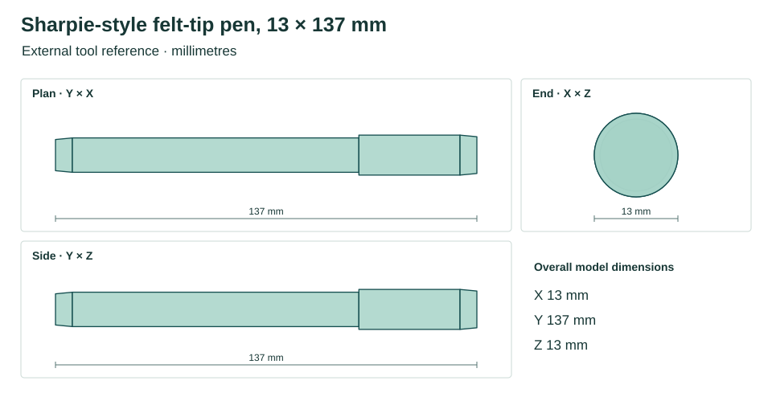
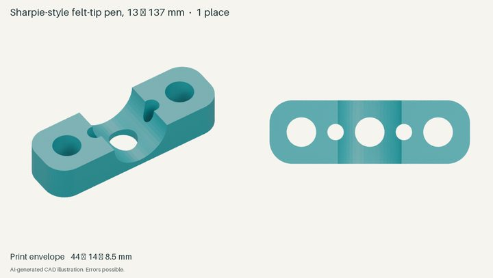

<!-- oomp-tools:start -->
# Sharpie-style felt-tip pen, 13 × 137 mm

`stationery_felt_tip_pen_13_mm_diameter_137_mm_length_sharpie_style`

**External tool reference.** Nominal capped body from the vertical holder's tool identity. The 14 mm pocket includes clearance. Cap and barrel split are illustrative.

[Dimension drawing](working.svg) · [Holder clearance drawing](holder_profile.svg) · [OpenSCAD](three_d_model/working.scad) · [STL · mm](three_d_model/working.stl) · [glTF · metres](three_d_model/working.glb) · [OOMP record](working.yaml)

## Sourcing and documentation

- Original vertical holder tool selection and pocket dimensions. [OOBB vertical holder recipe](https://github.com/oomlout/oomlout_oobb_part_tool_holder_vertical/blob/93a962a09e0c275c3cfa62187182ac3203bde1b2/scad.py)

## Holder layouts

| Layout | Places for this tool |
| --- | ---: |
| [marker sharpie style 13mm 1 place 3x1x17](../../HOLDERS.md#oobb_part_holder_tool_marker_sharpie_style_13mm_1_place_3x1x17) | 1 |
| [marker sharpie style 13mm 1 place 3x5x17](../../HOLDERS.md#oobb_part_holder_tool_marker_sharpie_style_13mm_1_place_3x5x17) | 1 |
| [marker sharpie style 13mm 2 place 4x5x17](../../HOLDERS.md#oobb_part_holder_tool_marker_sharpie_style_13mm_2_place_4x5x17) | 2 |
| [marker sharpie style 13mm 3 place 5x5x17](../../HOLDERS.md#oobb_part_holder_tool_marker_sharpie_style_13mm_3_place_5x5x17) | 3 |
| [marker sharpie style 13mm 4 place 7x5x17](../../HOLDERS.md#oobb_part_holder_tool_marker_sharpie_style_13mm_4_place_7x5x17) | 4 |
| [marker sharpie style 13mm 5 place 8x5x17](../../HOLDERS.md#oobb_part_holder_tool_marker_sharpie_style_13mm_5_place_8x5x17) | 5 |

Holder preview from [OOBB part holder v5](../../HOLDERS.md#oobb_part_holder_tool_marker_sharpie_style_13mm_1_place_3x1x17).
<!-- oomp-tools:end -->
