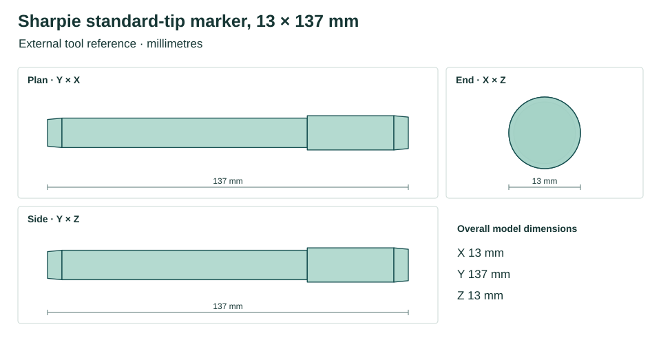
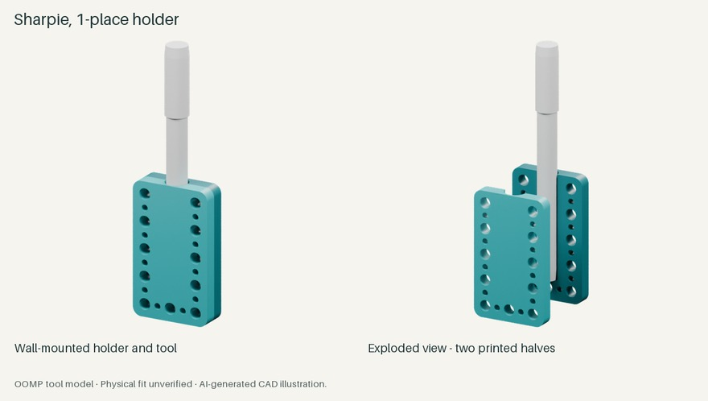

<!-- oomp-tools:start -->
# Sharpie standard-tip marker, 13 × 137 mm

[Tool catalogue](../../README.md) / [felt tip pen](../../navigation_oomp/stationery/felt_tip_pen/README.md)

`stationery_felt_tip_pen_sharpie_standard_tip_style_13_mm_diameter_137_mm_length_sharpie`

**External tool reference.** The standard-tip OOMP record matches the branded v4 profile in diameter and length. Cap and barrel split are illustrative.

## Model files

[OpenSCAD](three_d_model/working.scad) · [STL · mm](three_d_model/working.stl) · [glTF · metres](three_d_model/working.glb) · [OOMP record](working.yaml)

## Drawings and views

[Dimension drawing](working.svg) · [Holder clearance drawing](holder_profile.svg)

## Sourcing and documentation

- Upstream tool naming and clearance geometry used in the holder migration. [OOBB v4 tool shapes](https://github.com/oomlout/oomlout_oobb_version_4/blob/41f5386997faef4473c959dfb8c929864d7bf697/oobb_get_items_base_old.py)
- Legacy taxonomy, identity and archived sourcing fields. [Archived OOMP part](https://github.com/oomlout/oomlout_oomp_version_1_messy/tree/main/parts/stationery_felt_tip_pen_sharpie_standard_tip_style_13_mm_diameter_137_mm_length_sharpie)

## Holder layouts

| Layout | Places for this tool |
| --- | ---: |
| [marker sharpie 1 place 3x5x15](../../HOLDERS.md#oobb_part_holder_tool_marker_sharpie_1_place_3x5x15) | 1 |
| [marker sharpie 2 place 5x5x15](../../HOLDERS.md#oobb_part_holder_tool_marker_sharpie_2_place_5x5x15) | 2 |
| [marker sharpie 5 place 8x5x15](../../HOLDERS.md#oobb_part_holder_tool_marker_sharpie_5_place_8x5x15) | 5 |
| [marker sharpie 6 place 9x5x15](../../HOLDERS.md#oobb_part_holder_tool_marker_sharpie_6_place_9x5x15) | 6 |
| [mixed tools basic stand bench 7x10x66](../../HOLDERS.md#oobb_part_holder_tool_mixed_tools_basic_stand_bench_7x10x66) | 1 |

Holder preview from [OOBB part holder v5](https://github.com/oomlout/oomlout_oobb_part_holder_tool_version_5/blob/main/parts/oobb_part_holder_tool_marker_sharpie_1_place_3x5x15/README.md#assembly).

[Holder README and assembly instructions](https://github.com/oomlout/oomlout_oobb_part_holder_tool_version_5/blob/main/parts/oobb_part_holder_tool_marker_sharpie_1_place_3x5x15/README.md#assembly) · [Print booklet (PDF)](../../source_file/tool_references/holders/oobb_part_holder_tool_marker_sharpie_1_place_3x5x15.pdf)
<!-- oomp-tools:end -->
