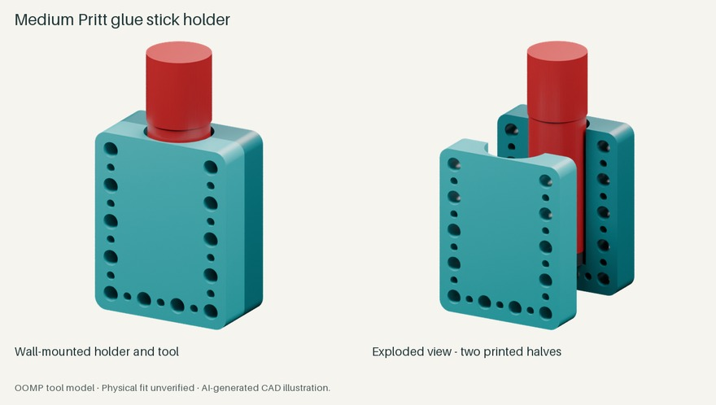

<!-- oomp-tools:start -->
# Medium Prit glue stick

[Tool catalogue](../../README.md) / [glue stick](../../navigation_oomp/stationery/glue_stick/README.md)

`stationery_glue_stick_medium_prit_style`

**External tool reference.** Representative PLUS Pritt medium NS-702, approximately 20 g and 26 × 95 mm. The red closed body and dark twist base are simplified, with estimated cap and base lengths. The workshop specimen has not been measured.

## Model files

[OpenSCAD](three_d_model/working.scad) · [STL · mm](three_d_model/working.stl) · [glTF · metres](three_d_model/working.glb) · [Blender scene](three_d_model/working.blend) · [OOMP record](working.yaml)

## Drawings and views

[Studio render](three_d_model/render.png) · [Top render](three_d_model/render_top.png) · [Dimension drawing](working.svg) · [Holder clearance drawing](holder_profile.svg)

## Sourcing and documentation

- Manufacturer lists medium, approximately 20 g, 26 mm diameter and 95 mm overall height. [PLUS Pritt medium NS-702](https://itemplus.plus.co.jp/catalog/DispDetail.do?itemID=t000100000385&volumeName=00016)
- Upstream tool naming and clearance geometry used in the holder migration. [OOBB v4 tool shapes](https://github.com/oomlout/oomlout_oobb_version_4/blob/41f5386997faef4473c959dfb8c929864d7bf697/oobb_get_items_base_old.py)

## Holder layouts

| Layout | Places for this tool |
| --- | ---: |
| [glue stick prit medium 1 place 4x5x30](../../HOLDERS.md#oobb_part_holder_tool_glue_stick_prit_medium_1_place_4x5x30) | 1 |
| [glue stick prit medium with knife 5x5x30](../../HOLDERS.md#oobb_part_holder_tool_glue_stick_prit_medium_with_knife_5x5x30) | 1 |

Holder preview from [OOBB part holder v5](https://github.com/oomlout/oomlout_oobb_part_holder_tool_version_5/blob/main/parts/oobb_part_holder_tool_glue_stick_prit_medium_1_place_4x5x30/README.md#assembly).

[Holder README and assembly instructions](https://github.com/oomlout/oomlout_oobb_part_holder_tool_version_5/blob/main/parts/oobb_part_holder_tool_glue_stick_prit_medium_1_place_4x5x30/README.md#assembly) · [Print booklet (PDF)](../../source_file/tool_references/holders/oobb_part_holder_tool_glue_stick_prit_medium_1_place_4x5x30.pdf)
<!-- oomp-tools:end -->
