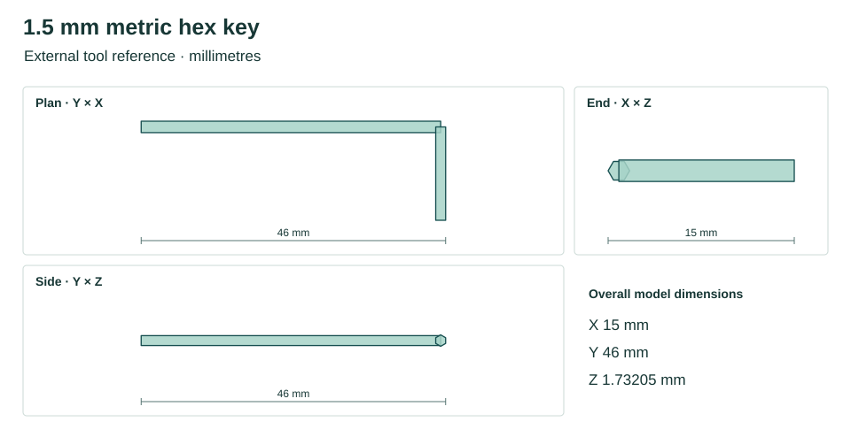
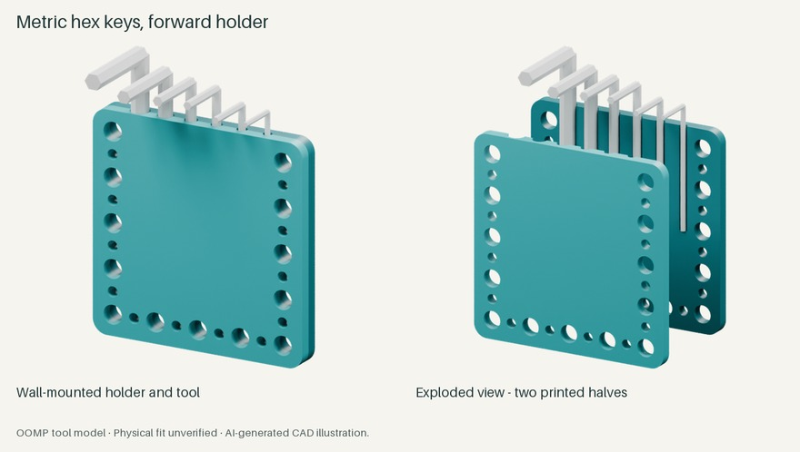

<!-- oomp-tools:start -->
# 1.5 mm metric hex key

[Tool catalogue](../../README.md) / [hex key](../../navigation_oomp/tool/hex_key/README.md)

`tool_hex_key_1_5_mm`

**External tool reference.** The holder specifies the hex size. Arm lengths follow the Wiha 350 short series as a representative example. The holder source leaves the key manufacturer unspecified. The elbow is simplified.

## Model files

[OpenSCAD](three_d_model/working.scad) · [STL · mm](three_d_model/working.stl) · [glTF · metres](three_d_model/working.glb) · [OOMP record](working.yaml)

## Drawings and views

[Dimension drawing](working.svg) · [Holder clearance drawing](holder_profile.svg)

## Sourcing and documentation

- Representative arm lengths by nominal hex size. [Wiha 350 short hex key dimensions](https://digicat.wiha.com/int/en/tools/l-keys/wiha-individual-key/hexagon-socket/l-keys/01126)
- Upstream tool naming and clearance geometry used in the holder migration. [OOBB v4 tool shapes](https://github.com/oomlout/oomlout_oobb_version_4/blob/41f5386997faef4473c959dfb8c929864d7bf697/oobb_get_items_base_old.py)

## Holder layouts

| Layout | Places for this tool |
| --- | ---: |
| [hex key small metric set 6 forward 5x5x8](../../HOLDERS.md#oobb_part_holder_tool_hex_key_small_metric_set_6_forward_5x5x8) | 1 |
| [hex key small metric set 6 reverse 5x5x8](../../HOLDERS.md#oobb_part_holder_tool_hex_key_small_metric_set_6_reverse_5x5x8) | 1 |
| [mixed tools basic stand bench 7x10x66](../../HOLDERS.md#oobb_part_holder_tool_mixed_tools_basic_stand_bench_7x10x66) | 1 |

Holder preview from [OOBB part holder v5](../../HOLDERS.md#oobb_part_holder_tool_hex_key_small_metric_set_6_forward_5x5x8).
<!-- oomp-tools:end -->
