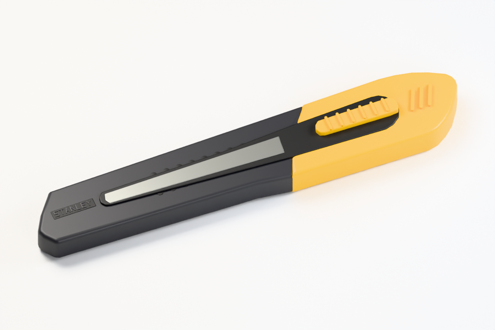
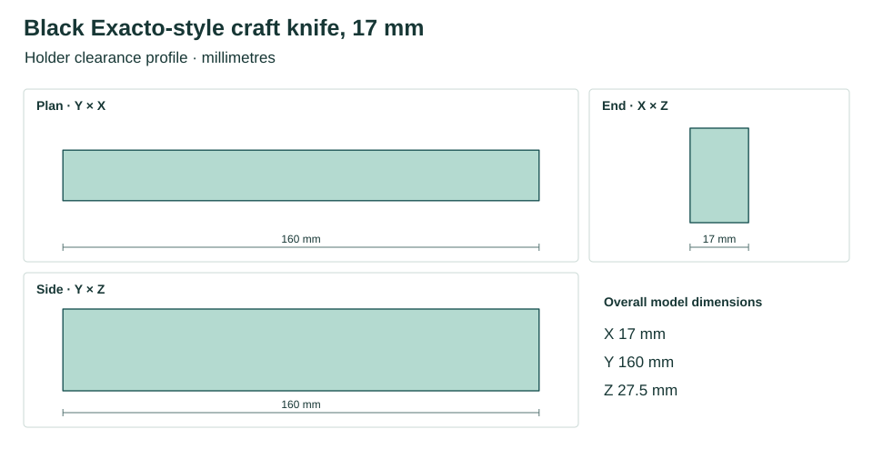

<!-- oomp-tools:start -->
# Closed utility knife, 17 mm

[Tool catalogue](../../README.md) / [knife craft](../../navigation_oomp/tool/knife_craft/README.md)

`tool_knife_craft_17_mm_black_exacto_style`

**Photo-based tool model.** Closed exterior based on the photo and a provisional 165 mm STANLEY 0-10-151 reference. The 17 mm OOMP label is retained. Size variant awaits measurement.

Exacto is the holder project's spelling. The source gives no manufacturer article number.

## Photograph and measurements

[Workshop photograph](PXL_20261119_134702730.jpg) · [Measurements and assumptions](measurements.md) · [Photo with model outline](photo_overlay.svg) · [Identification research (2026-11-19)](research_2026-11-19.md)

## Model files

[OpenSCAD](three_d_model/working.scad) · [STL · mm](three_d_model/working.stl) · [glTF · metres](three_d_model/working.glb) · [Blender scene](three_d_model/working.blend) · [OOMP record](working.yaml)

## Drawings and views

[Studio render](three_d_model/render.png) · [Top render](three_d_model/render_top.png) · [Dimension drawing](working.svg) · [Holder clearance drawing](holder_profile.svg)

## Sourcing and documentation

- Upstream tool naming and clearance geometry used in the holder migration. [OOBB v4 tool shapes](https://github.com/oomlout/oomlout_oobb_version_4/blob/41f5386997faef4473c959dfb8c929864d7bf697/oobb_get_items_base_old.py)

## Holder layouts

| Layout | Places for this tool |
| --- | ---: |
| [glue stick prit medium with knife 5x5x30](../../HOLDERS.md#oobb_part_holder_tool_glue_stick_prit_medium_with_knife_5x5x30) | 1 |
| [knife utility 17mm 1 place 3x5x29d5](../../HOLDERS.md#oobb_part_holder_tool_knife_utility_17mm_1_place_3x5x29d5) | 1 |
| [mixed tools basic stand bench 7x10x66](../../HOLDERS.md#oobb_part_holder_tool_mixed_tools_basic_stand_bench_7x10x66) | 1 |
| [screwdriver quikpik 200mm with knife 5x5x38](../../HOLDERS.md#oobb_part_holder_tool_screwdriver_quikpik_200mm_with_knife_5x5x38) | 1 |

Holder preview from [OOBB part holder v5](https://github.com/oomlout/oomlout_oobb_part_holder_tool_version_5/blob/main/parts/oobb_part_holder_tool_glue_stick_prit_medium_with_knife_5x5x30/README.md#assembly).

[Holder README and assembly instructions](https://github.com/oomlout/oomlout_oobb_part_holder_tool_version_5/blob/main/parts/oobb_part_holder_tool_glue_stick_prit_medium_with_knife_5x5x30/README.md#assembly) · [Print booklet (PDF)](../../source_file/tool_references/holders/oobb_part_holder_tool_glue_stick_prit_medium_with_knife_5x5x30.pdf)
<!-- oomp-tools:end -->
