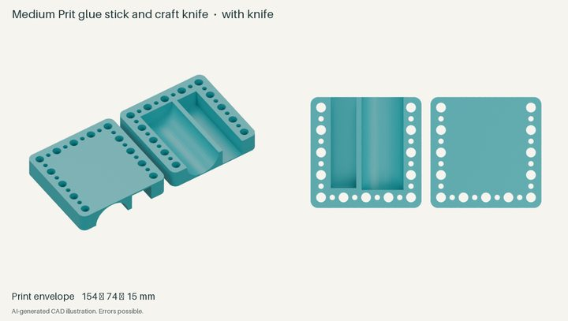

<!-- oomp-tools:start -->
# Black Exacto-style craft knife, 17 mm

`tool_knife_craft_17_mm_black_exacto_style`

**Holder clearance profile.** Geometry follows the holder clearance profile. Its dimensions describe the pocket used in the source design. Physical tool dimensions and fit have yet to be measured.

Exacto is the holder project's spelling. The source gives no manufacturer article number.

[Dimension drawing](working.svg) · [OpenSCAD](three_d_model/working.scad) · [STL · mm](three_d_model/working.stl) · [glTF · metres](three_d_model/working.glb) · [OOMP record](working.yaml)

## Sourcing and documentation

- Upstream tool naming and clearance geometry used in the holder migration. [OOBB v4 tool shapes](https://github.com/oomlout/oomlout_oobb_version_4/blob/41f5386997faef4473c959dfb8c929864d7bf697/oobb_get_items_base_old.py)

## Holder layouts

| Layout | Places for this tool |
| --- | ---: |
| [glue stick prit medium with knife 5x5x30](../../HOLDERS.md#oobb_part_holder_tool_glue_stick_prit_medium_with_knife_5x5x30) | 1 |
| [knife exacto 17mm 1 place 3x5x29d5](../../HOLDERS.md#oobb_part_holder_tool_knife_exacto_17mm_1_place_3x5x29d5) | 1 |
| [mixed tools basic stand bench 7x10x66](../../HOLDERS.md#oobb_part_holder_tool_mixed_tools_basic_stand_bench_7x10x66) | 1 |
| [screwdriver quikpik 200mm with knife 5x5x38](../../HOLDERS.md#oobb_part_holder_tool_screwdriver_quikpik_200mm_with_knife_5x5x38) | 1 |

Holder preview from [OOBB part holder v5](../../HOLDERS.md#oobb_part_holder_tool_glue_stick_prit_medium_with_knife_5x5x30).
<!-- oomp-tools:end -->
