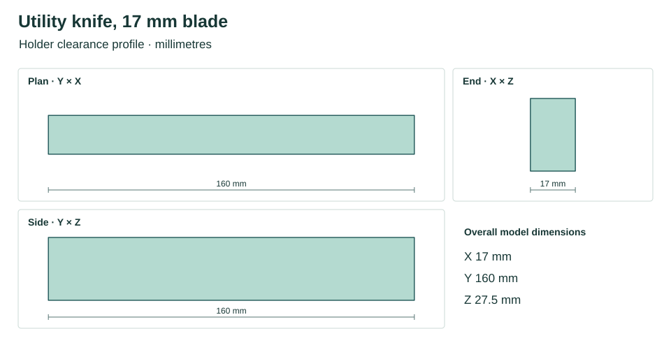
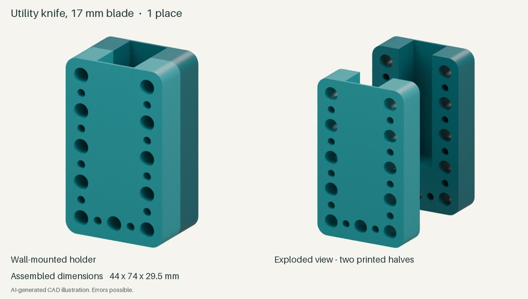

<!-- oomp-tools:start -->
# Utility knife, 17 mm blade

[Tool catalogue](../../README.md) / [knife utility](../../navigation_oomp/tool/knife_utility/README.md)

`tool_knife_utility_17_mm_blade`

**Holder clearance profile.** Geometry follows the holder clearance profile. Its dimensions describe the pocket used in the source design. Physical tool dimensions and fit have yet to be measured.

## Model files

[OpenSCAD](three_d_model/working.scad) · [STL · mm](three_d_model/working.stl) · [glTF · metres](three_d_model/working.glb) · [OOMP record](working.yaml)

## Drawings and views

[Dimension drawing](working.svg)

## Sourcing and documentation

- Upstream tool naming and clearance geometry used in the holder migration. [OOBB v4 tool shapes](https://github.com/oomlout/oomlout_oobb_version_4/blob/41f5386997faef4473c959dfb8c929864d7bf697/oobb_get_items_base_old.py)
- Legacy taxonomy, identity and archived sourcing fields. [Archived OOMP part](https://github.com/oomlout/oomlout_oomp_version_1_messy/tree/main/parts/tool_knife_utility_17_mm_blade)

## Holder layouts

| Layout | Places for this tool |
| --- | ---: |
| [knife utility 17mm 1 place 3x5x29d5](../../HOLDERS.md#oobb_part_holder_tool_knife_utility_17mm_1_place_3x5x29d5) | 1 |

Holder preview from [OOBB part holder v5](../../HOLDERS.md#oobb_part_holder_tool_knife_utility_17mm_1_place_3x5x29d5).
<!-- oomp-tools:end -->
