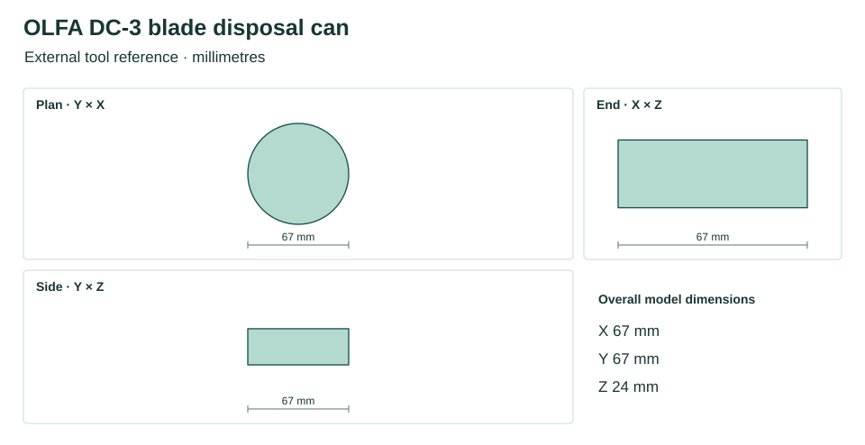
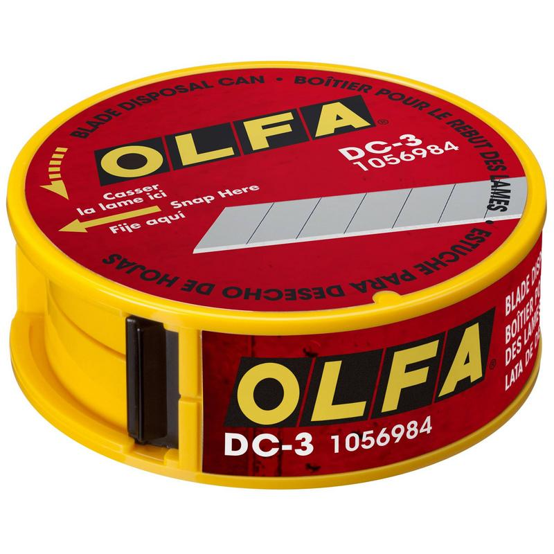
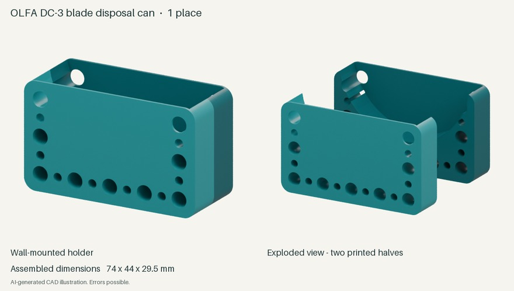

<!-- oomp-tools:start -->
# OLFA DC-3 blade disposal can

[Tool catalogue](../../README.md) / [knife utility blade disposal can](../../navigation_oomp/tool/knife_utility_blade_disposal_can/README.md)

`tool_knife_utility_blade_disposal_can_olfa_dc_3`

**External tool reference.** Round body approximation using OLFA's overall length and thickness. The sliding door and rim details are omitted.

## Model files

[OpenSCAD](three_d_model/working.scad) · [STL · mm](three_d_model/working.stl) · [glTF · metres](three_d_model/working.glb) · [OOMP record](working.yaml)

## Drawings and views

[Dimension drawing](working.svg) · [Holder clearance drawing](holder_profile.svg)

## Sourcing and documentation

- Overall length of 67 mm and thickness of 24 mm. [OLFA Corporation DC-3 dimensions](https://www.olfa.co.jp/en/products/504.html)
- Identifies the pocket disposal can and OLFA article 1056984. [OLFA DC-3 product page](https://olfa.com/products/dc-3-pocket-size-blade-disposal-can)
- Manufacturer photograph of the DC-3. [OLFA product photograph](https://olfa.com/cdn/shop/products/2e875173077f4421b16fb9e034db3cad.800.jpg?v=1629300618) · [Local copy](image.jpg)
- Upstream tool naming and clearance geometry used in the holder migration. [OOBB v4 tool shapes](https://github.com/oomlout/oomlout_oobb_version_4/blob/41f5386997faef4473c959dfb8c929864d7bf697/oobb_get_items_base_old.py)
- Legacy taxonomy, identity and archived sourcing fields. [Archived OOMP part](https://github.com/oomlout/oomlout_oomp_version_1_messy/tree/main/parts/tool_knife_utility_blade_disposal_can_olfa_dc_3)

## Holder layouts

| Layout | Places for this tool |
| --- | ---: |
| [blade disposal olfa dc3 1 place 5x3x29d5](../../HOLDERS.md#oobb_part_holder_tool_blade_disposal_olfa_dc3_1_place_5x3x29d5) | 1 |

Holder preview from [OOBB part holder v5](../../HOLDERS.md#oobb_part_holder_tool_blade_disposal_olfa_dc3_1_place_5x3x29d5).
<!-- oomp-tools:end -->
