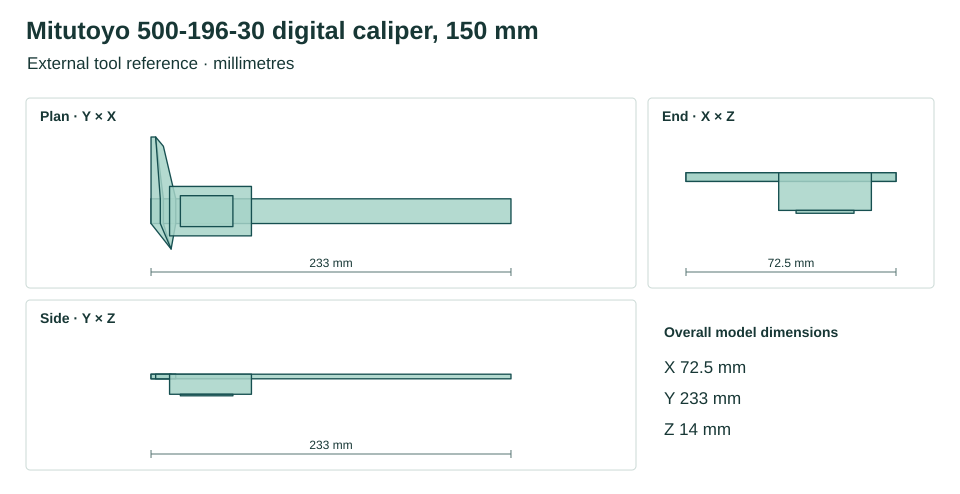
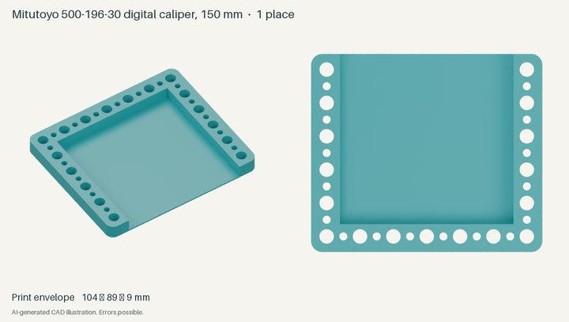

<!-- oomp-tools:start -->
# Mitutoyo 500-196-30 digital caliper, 150 mm

[Tool catalogue](../../README.md) / [measure caliper digital](../../navigation_oomp/tool/measure_caliper_digital/README.md)

`tool_measure_caliper_digital_150_mm_length_mitutoyo_mit500_196_30`

**External tool reference.** Closed caliper. Overall length, beam width and outside jaw length follow the Mitutoyo dimensional drawing. Slider, jaws and display are simplified for identification.

## Model files

[OpenSCAD](three_d_model/working.scad) · [STL · mm](three_d_model/working.stl) · [glTF · metres](three_d_model/working.glb) · [OOMP record](working.yaml)

## Drawings and views

[Dimension drawing](working.svg) · [Holder clearance drawing](holder_profile.svg)

## Sourcing and documentation

- Model identity, range and dimensional drawing. [Mitutoyo AOS dimensional catalogue](https://www.mitutoyo.com/webfoo/wp-content/uploads/2129-AOS-Calipers.pdf) · [Local copy](datasheet.pdf)
- Upstream tool naming and clearance geometry used in the holder migration. [OOBB v4 tool shapes](https://github.com/oomlout/oomlout_oobb_version_4/blob/41f5386997faef4473c959dfb8c929864d7bf697/oobb_get_items_base_old.py)
- Legacy taxonomy, identity and archived sourcing fields. [Archived OOMP part](https://github.com/oomlout/oomlout_oomp_version_1_messy/tree/main/parts/tool_measure_caliper_digital_150_mm_length_mitutoyo_mit500_196_30)
- Original CorelDRAW reference drawing. [Archived OOMP outline](https://github.com/oomlout/oomlout_oomp_version_1_messy/blob/main/parts/tool_measure_caliper_digital_150_mm_length_mitutoyo_mit500_196_30/drawing.cdr) · [Local copy](drawing.cdr)
- Archived distributor reference [Amazon UK B00IG46NL2](https://www.amazon.co.uk/gp/product/B00IG46NL2).

## Holder layouts

| Layout | Places for this tool |
| --- | ---: |
| [caliper mitutoyo 500 196 30 1 place 7x6x18](../../HOLDERS.md#oobb_part_holder_tool_caliper_mitutoyo_500_196_30_1_place_7x6x18) | 1 |

Holder preview from [OOBB part holder v5](../../HOLDERS.md#oobb_part_holder_tool_caliper_mitutoyo_500_196_30_1_place_7x6x18).
<!-- oomp-tools:end -->
