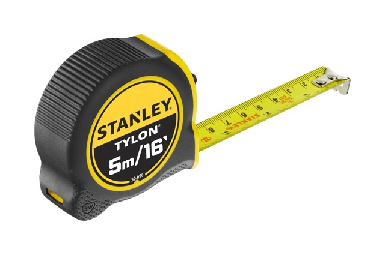
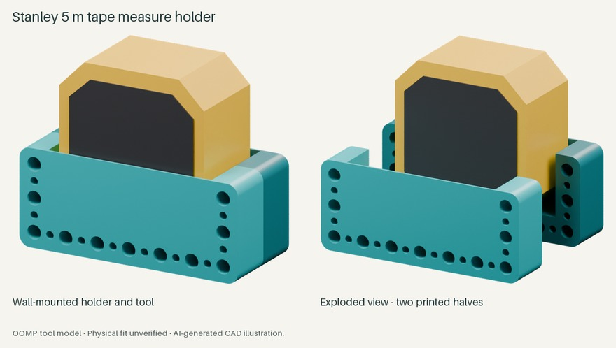

<!-- oomp-tools:start -->
# Stanley 1-30-696 tape measure, 5 m

[Tool catalogue](../../README.md) / [measure tape measure](../../navigation_oomp/tool/measure_tape_measure/README.md)

`tool_measure_tape_measure_5000_mm_length_stanley_1_30_696`

**External tool reference.** Retracted Stanley Tylon 1-30-696, modelled with a 69 × 72 × 40 mm case from a distributor listing. The outline and coloured face follow the manufacturer photograph. The lock, hook and belt clip are simplified or omitted; dimensions and physical fit require confirmation on the actual tool.

## Model files

[OpenSCAD](three_d_model/working.scad) · [STL · mm](three_d_model/working.stl) · [glTF · metres](three_d_model/working.glb) · [Blender scene](three_d_model/working.blend) · [OOMP record](working.yaml)

## Drawings and views

[Studio render](three_d_model/render.png) · [Top render](three_d_model/render_top.png) · [Dimension drawing](working.svg) · [Holder clearance drawing](holder_profile.svg)

## Sourcing and documentation

- Product identity, 5 m tape, 19 mm blade and case photograph. [Stanley Tylon 1-30-696](https://www.stanleytools.co.uk/en-gb/product/1-30-696/tylon-16-ft5m-19mm-wide-tape-measure-12-pk) · [Local copy](image.jpg)
- Distributor lists 69 mm width, 72 mm height and 40 mm depth. [Arcmaster Tylon 1-30-696 dimensions](https://arcmaster.uk.com/product/stanley-tylon-pocket-tape-measure-5m-16ft/)
- Independent distributor lists approximately 70 × 41 × 71 mm. [L&S 1-30-696 size](https://www.lsengineers.co.uk/pocket-tape-5m-16ft-width-19mm-loose-by-stanley-1-30-696.html)
- Upstream tool naming and clearance geometry used in the holder migration. [OOBB v4 tool shapes](https://github.com/oomlout/oomlout_oobb_version_4/blob/41f5386997faef4473c959dfb8c929864d7bf697/oobb_get_items_base_old.py)
- Legacy taxonomy, identity and archived sourcing fields. [Archived OOMP part](https://github.com/oomlout/oomlout_oomp_version_1_messy/tree/main/parts/tool_measure_tape_measure_5000_mm_length_stanley_1_30_696)
- Archived distributor reference [Amazon UK B000Y8W54C](https://www.amazon.co.uk/gp/product/B000Y8W54C).

## Holder layouts

| Layout | Places for this tool |
| --- | ---: |
| [tape measure stanley 1 30 696 1 place 7x3x44](../../HOLDERS.md#oobb_part_holder_tool_tape_measure_stanley_1_30_696_1_place_7x3x44) | 1 |

Holder preview from [OOBB part holder v5](https://github.com/oomlout/oomlout_oobb_part_holder_tool_version_5/blob/main/parts/oobb_part_holder_tool_tape_measure_stanley_1_30_696_1_place_7x3x44/README.md#assembly).

[Holder README and assembly instructions](https://github.com/oomlout/oomlout_oobb_part_holder_tool_version_5/blob/main/parts/oobb_part_holder_tool_tape_measure_stanley_1_30_696_1_place_7x3x44/README.md#assembly) · [Print booklet (PDF)](../../source_file/tool_references/holders/oobb_part_holder_tool_tape_measure_stanley_1_30_696_1_place_7x3x44.pdf)
<!-- oomp-tools:end -->
