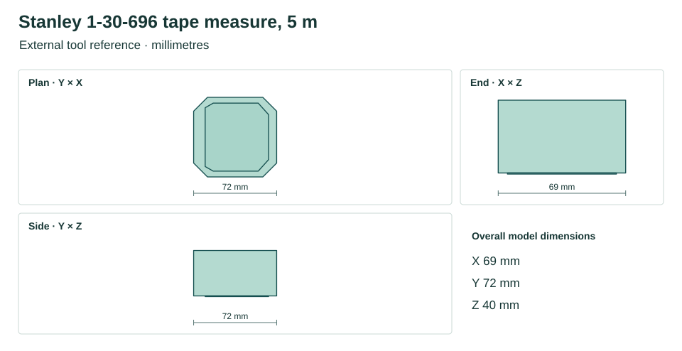

<!-- oomp-tools:start -->
# Stanley 1-30-696 tape measure, 5 m

[Tool catalogue](../../README.md) / [measure tape measure](../../navigation_oomp/tool/measure_tape_measure/README.md)

`tool_measure_tape_measure_5000_mm_length_stanley_1_30_696`

**Holder clearance profile.** Geometry follows the holder clearance profile. Its dimensions describe the pocket used in the source design. Physical tool dimensions and fit have yet to be measured.

## Model files

[OpenSCAD](three_d_model/working.scad) · [STL · mm](three_d_model/working.stl) · [glTF · metres](three_d_model/working.glb) · [OOMP record](working.yaml)

## Drawings and views

[Dimension drawing](working.svg)

## Sourcing and documentation

- Upstream tool naming and clearance geometry used in the holder migration. [OOBB v4 tool shapes](https://github.com/oomlout/oomlout_oobb_version_4/blob/41f5386997faef4473c959dfb8c929864d7bf697/oobb_get_items_base_old.py)
- Legacy taxonomy, identity and archived sourcing fields. [Archived OOMP part](https://github.com/oomlout/oomlout_oomp_version_1_messy/tree/main/parts/tool_measure_tape_measure_5000_mm_length_stanley_1_30_696)
- Archived distributor reference [Amazon UK B000Y8W54C](https://www.amazon.co.uk/gp/product/B000Y8W54C).

## Holder layouts

| Layout | Places for this tool |
| --- | ---: |
| [tape measure stanley 1 30 696 1 place 7x3x44](../../HOLDERS.md#oobb_part_holder_tool_tape_measure_stanley_1_30_696_1_place_7x3x44) | 1 |

Holder preview from [OOBB part holder v5](../../HOLDERS.md#oobb_part_holder_tool_tape_measure_stanley_1_30_696_1_place_7x3x44).
<!-- oomp-tools:end -->
