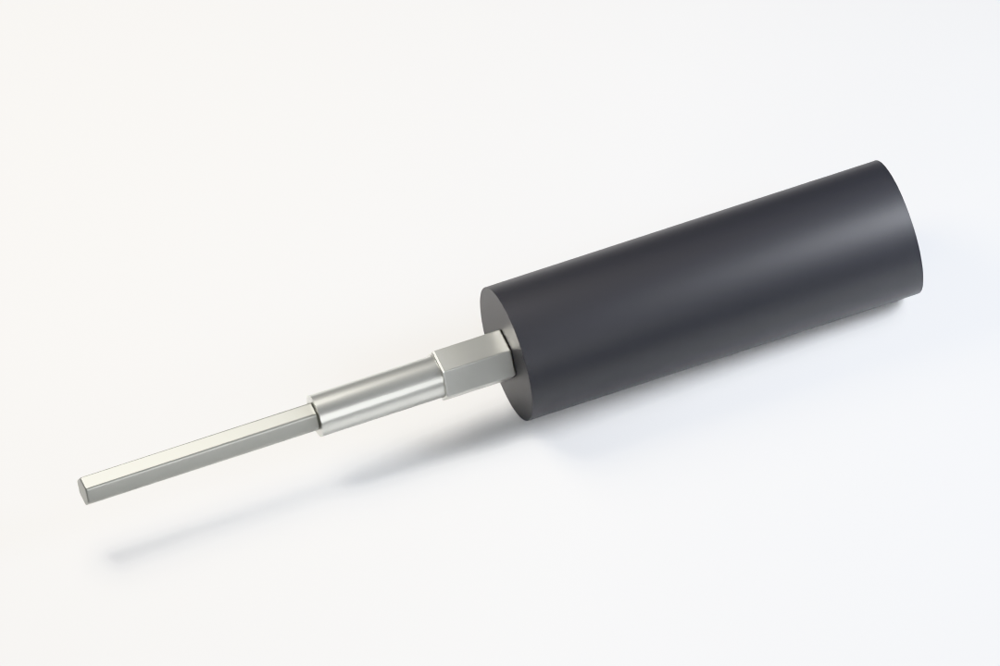
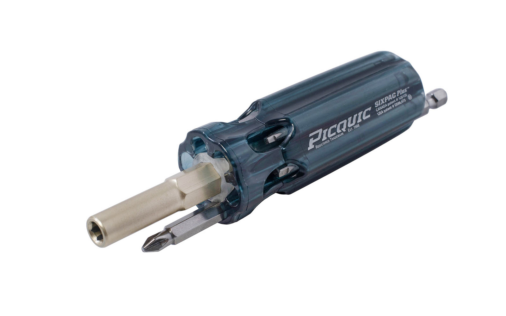

<!-- oomp-tools:start -->
# Quikpik multi-driver, 200 mm

[Tool catalogue](../../README.md) / [screw driver multi driver](../../navigation_oomp/tool/screw_driver_multi_driver/README.md)

`tool_screw_driver_multi_driver_200_mm_quikpik`

**External tool reference.** Representative Picquic SIXPAC Plus, 200 mm overall and 32 mm handle diameter from a distributor listing. Picquic specifies 3-inch quarter-inch bits and a 7/16-inch hex bolster. Exposed bit, shank and bolster lengths are estimates for the stored-bit pose. The handle contour, stored bits and workshop specimen have not been measured.

## Model files

[OpenSCAD](three_d_model/working.scad) · [STL · mm](three_d_model/working.stl) · [glTF · metres](three_d_model/working.glb) · [Blender scene](three_d_model/working.blend) · [OOMP record](working.yaml)

## Drawings and views

[Studio render](three_d_model/render.png) · [Top render](three_d_model/render_top.png) · [Dimension drawing](working.svg) · [Holder clearance drawing](holder_profile.svg)

## Sourcing and documentation

- Manufacturer identifies three-inch quarter-inch bits and a 7/16-inch hex bolster. [Picquic SIXPAC Plus](https://picquic.ca/sixpac-plus/)
- Distributor lists 200 mm overall length, 32 mm diameter and 76.2 mm bits. [Picquic SIXPAC Plus dimensions](https://www.harrant.cz/zbozi/picquic-sroubovak-s-vymennymi-bity-sixpac-plus-2/?parameterValueId=3122)
- Reference view of handle, shank and bit storage. [Picquic SIXPAC Plus product photograph](https://hardwickandsons.com/products/picquic-sixpac-plus-multi-bit-screwdriver) · [Local copy](image.jpg)
- Upstream tool naming and clearance geometry used in the holder migration. [OOBB v4 tool shapes](https://github.com/oomlout/oomlout_oobb_version_4/blob/41f5386997faef4473c959dfb8c929864d7bf697/oobb_get_items_base_old.py)

## Holder layouts

| Layout | Places for this tool |
| --- | ---: |
| [mixed tools basic stand bench 7x10x66](../../HOLDERS.md#oobb_part_holder_tool_mixed_tools_basic_stand_bench_7x10x66) | 1 |
| [screwdriver quikpik 200mm with knife 5x5x38](../../HOLDERS.md#oobb_part_holder_tool_screwdriver_quikpik_200mm_with_knife_5x5x38) | 1 |

Holder preview from [OOBB part holder v5](https://github.com/oomlout/oomlout_oobb_part_holder_tool_version_5/blob/main/parts/oobb_part_holder_tool_mixed_tools_basic_stand_bench_7x10x66/README.md#assembly).

[Holder README and assembly instructions](https://github.com/oomlout/oomlout_oobb_part_holder_tool_version_5/blob/main/parts/oobb_part_holder_tool_mixed_tools_basic_stand_bench_7x10x66/README.md#assembly) · [Print booklet (PDF)](../../source_file/tool_references/holders/oobb_part_holder_tool_mixed_tools_basic_stand_bench_7x10x66.pdf)
<!-- oomp-tools:end -->
