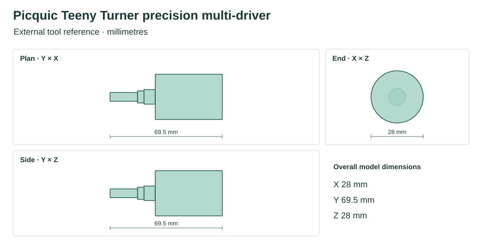
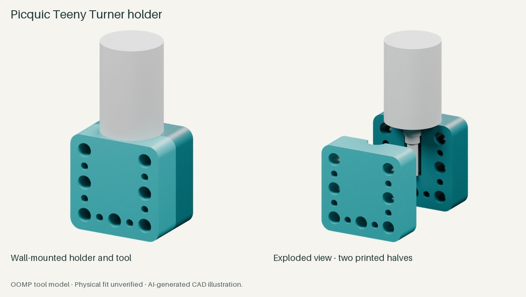

<!-- oomp-tools:start -->
# Picquic Teeny Turner precision multi-driver

[Tool catalogue](../../README.md) / [screw driver multi driver](../../navigation_oomp/tool/screw_driver_multi_driver/README.md)

`tool_screw_driver_multi_driver_precision_size_teeny_turner_model_picquic`

**External tool reference.** Four coaxial sections follow the archived OOMP drawing, read at its document scale. The handle and exposed bit use simplified round sections.

## Model files

[OpenSCAD](three_d_model/working.scad) · [STL · mm](three_d_model/working.stl) · [glTF · metres](three_d_model/working.glb) · [OOMP record](working.yaml)

## Drawings and views

[Dimension drawing](working.svg) · [Holder clearance drawing](holder_profile.svg)

## Sourcing and documentation

- Product identification and supplied bits. [Picquic Teeny Turner](https://picquic.ca/teeny-turner/)
- Original vertical holder tool selection and pocket dimensions. [OOBB vertical holder recipe](https://github.com/oomlout/oomlout_oobb_part_tool_holder_vertical/blob/93a962a09e0c275c3cfa62187182ac3203bde1b2/scad.py)
- Legacy taxonomy, identity and archived sourcing fields. [Archived OOMP part](https://github.com/oomlout/oomlout_oomp_version_1_messy/tree/main/parts/tool_screw_driver_multi_driver_precision_size_teeny_turner_model_picquic)
- Original CorelDRAW reference drawing. [Archived OOMP outline](https://github.com/oomlout/oomlout_oomp_version_1_messy/blob/main/parts/tool_screw_driver_multi_driver_precision_size_teeny_turner_model_picquic/drawing.cdr) · [Local copy](drawing.cdr)

## Holder layouts

| Layout | Places for this tool |
| --- | ---: |
| [screwdriver picquic teeny turner 1 place 3x3x31](../../HOLDERS.md#oobb_part_holder_tool_screwdriver_picquic_teeny_turner_1_place_3x3x31) | 1 |

Holder preview from [OOBB part holder v5](https://github.com/oomlout/oomlout_oobb_part_holder_tool_version_5/blob/main/parts/oobb_part_holder_tool_screwdriver_picquic_teeny_turner_1_place_3x3x31/README.md#assembly).

[Holder README and assembly instructions](https://github.com/oomlout/oomlout_oobb_part_holder_tool_version_5/blob/main/parts/oobb_part_holder_tool_screwdriver_picquic_teeny_turner_1_place_3x3x31/README.md#assembly) · [Print booklet (PDF)](../../source_file/tool_references/holders/oobb_part_holder_tool_screwdriver_picquic_teeny_turner_1_place_3x3x31.pdf)
<!-- oomp-tools:end -->
