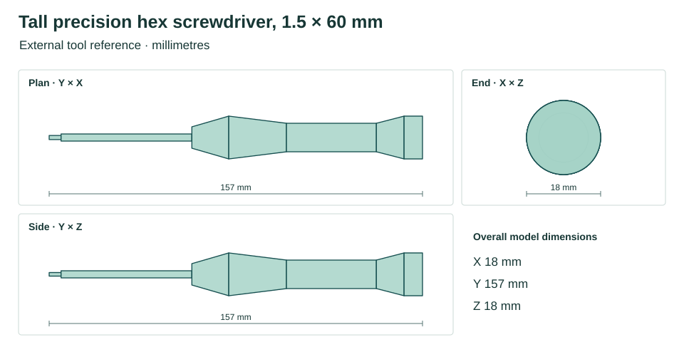
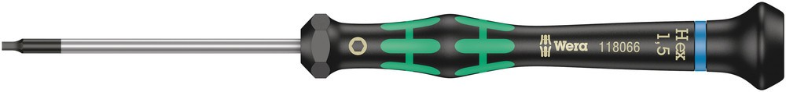
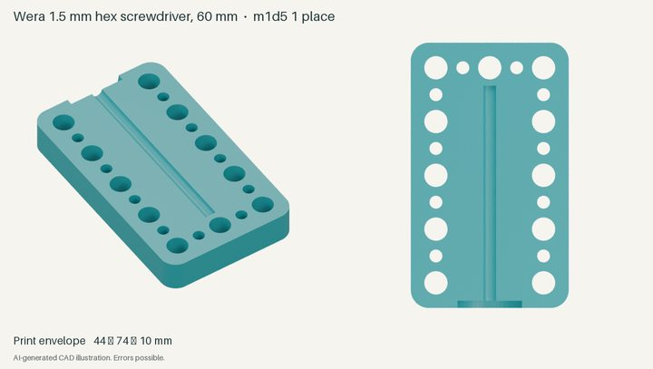

<!-- oomp-tools:start -->
# Wera 2054 Micro hex screwdriver, 1.5 × 60 mm

`tool_screw_driver_precision_kraftform_micro_style_18_mm_diameter_157_mm_depth_hex_head_1_5_mm_wera_2054_series_05118066001`

**External tool reference.** Wera specifies the shaft diameter, shaft length and handle length. The archived OOMP record supplies the 18 mm handle envelope. Grip taper, cap and tip transition are illustrative.

[Dimension drawing](working.svg) · [Holder clearance drawing](holder_profile.svg) · [OpenSCAD](three_d_model/working.scad) · [STL · mm](three_d_model/working.stl) · [glTF · metres](three_d_model/working.glb) · [OOMP record](working.yaml)

## Sourcing and documentation

- Article number, hex size, blade diameter and lengths. [Wera 2054 Micro datasheet](https://hybris-media.wera.de/download/pdfgenerator-datasheets/en/05118066001.pdf) · [Local copy](datasheet.pdf)
- Upstream tool naming and clearance geometry used in the holder migration. [OOBB v4 tool shapes](https://github.com/oomlout/oomlout_oobb_version_4/blob/41f5386997faef4473c959dfb8c929864d7bf697/oobb_get_items_base_old.py)
- Legacy taxonomy, identity and archived sourcing fields. [Archived OOMP part](https://github.com/oomlout/oomlout_oomp_version_1_messy/tree/main/parts/tool_screw_driver_precision_kraftform_micro_style_18_mm_diameter_157_mm_depth_hex_head_1_5_mm_wera_2054_series_05118066001)

## Holder layouts

| Layout | Places for this tool |
| --- | ---: |
| [mixed tools basic stand bench 7x10x66](../../HOLDERS.md#oobb_part_holder_tool_mixed_tools_basic_stand_bench_7x10x66) | 1 |
| [screwdriver wera hex 60mm m1d5 1 place 3x5x20](../../HOLDERS.md#oobb_part_holder_tool_screwdriver_wera_hex_60mm_m1d5_1_place_3x5x20) | 1 |

Holder preview from [OOBB part holder v5](../../HOLDERS.md#oobb_part_holder_tool_screwdriver_wera_hex_60mm_m1d5_1_place_3x5x20).
<!-- oomp-tools:end -->
