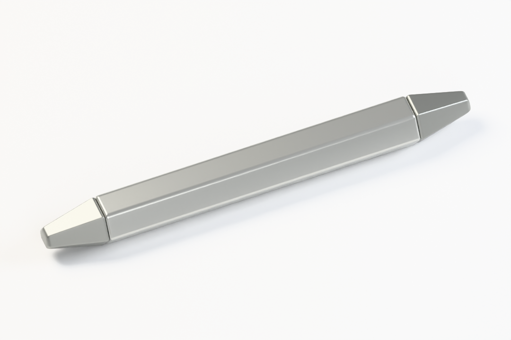
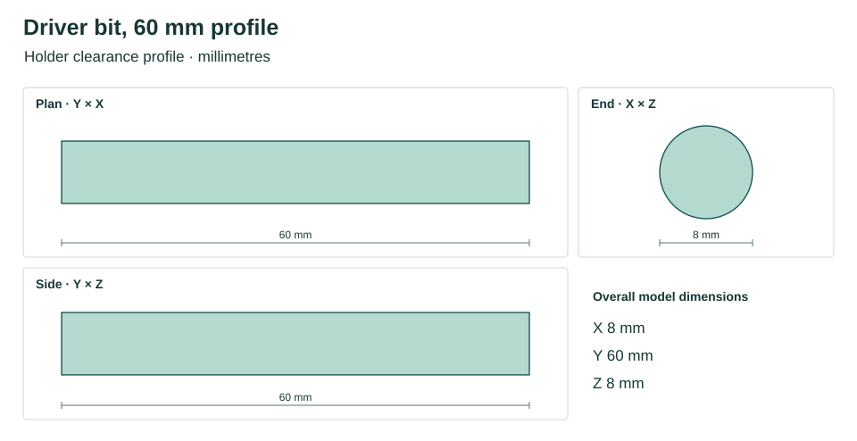

<!-- oomp-tools:start -->
# Driver bit, 60 mm profile

[Tool catalogue](../../README.md) / [screwdriver bit](../../navigation_oomp/tool/screwdriver_bit/README.md)

`tool_screwdriver_bit_60_mm_profile`

**External tool reference.** Representative 60 mm quarter-inch double-ended PH2/PZ2 bit. Length and drive size follow the HiKOKI product. The tapered hexagonal tips are simplified and their length and end diameter are estimates.

## Model files

[OpenSCAD](three_d_model/working.scad) · [STL · mm](three_d_model/working.stl) · [glTF · metres](three_d_model/working.glb) · [Blender scene](three_d_model/working.blend) · [OOMP record](working.yaml)

## Drawings and views

[Studio render](three_d_model/render.png) · [Top render](three_d_model/render_top.png) · [Dimension drawing](working.svg) · [Holder clearance drawing](holder_profile.svg)

## Sourcing and documentation

- Overall length, quarter-inch drive and PH2/PZ2 ends. [HiKOKI 60 mm double-ended PH/PZ bits](https://hikoki-powertools.eu/uk/en/machines-accessories/3-bits-1-4-double-ended-phillips-pozidrive-ph1-pz1-ph2-pz2-ph3-pz3-60mm/)
- Upstream tool naming and clearance geometry used in the holder migration. [OOBB v4 tool shapes](https://github.com/oomlout/oomlout_oobb_version_4/blob/41f5386997faef4473c959dfb8c929864d7bf697/oobb_get_items_base_old.py)

## Holder layouts

| Layout | Places for this tool |
| --- | ---: |
| [driver bit driver bit 60mm 1 place 3x3x10](../../HOLDERS.md#oobb_part_holder_tool_driver_bit_driver_bit_60mm_1_place_3x3x10) | 1 |
| [driver bit driver bit 60mm 4 place 5x3x10](../../HOLDERS.md#oobb_part_holder_tool_driver_bit_driver_bit_60mm_4_place_5x3x10) | 4 |
| [driver bit driver bit 60mm 6 place 7x3x10](../../HOLDERS.md#oobb_part_holder_tool_driver_bit_driver_bit_60mm_6_place_7x3x10) | 6 |
| [driver bit driver bit 60mm 8 place 9x3x10](../../HOLDERS.md#oobb_part_holder_tool_driver_bit_driver_bit_60mm_8_place_9x3x10) | 8 |

Holder preview from [OOBB part holder v5](https://github.com/oomlout/oomlout_oobb_part_holder_tool_version_5/blob/main/parts/oobb_part_holder_tool_driver_bit_driver_bit_60mm_1_place_3x3x10/README.md#assembly).

[Holder README and assembly instructions](https://github.com/oomlout/oomlout_oobb_part_holder_tool_version_5/blob/main/parts/oobb_part_holder_tool_driver_bit_driver_bit_60mm_1_place_3x3x10/README.md#assembly) · [Print booklet (PDF)](../../source_file/tool_references/holders/oobb_part_holder_tool_driver_bit_driver_bit_60mm_1_place_3x3x10.pdf)
<!-- oomp-tools:end -->
