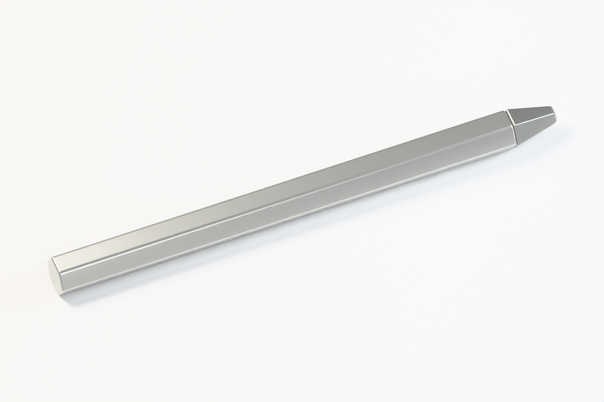
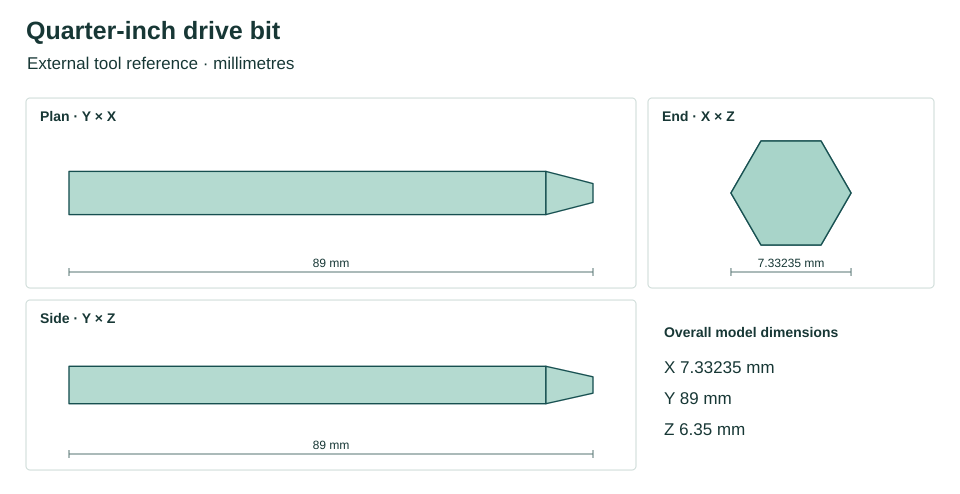

<!-- oomp-tools:start -->
# Quarter-inch drive bit

[Tool catalogue](../../README.md) / [screwdriver bit](../../navigation_oomp/tool/screwdriver_bit/README.md)

`tool_screwdriver_bit_quarter_inch_drive`

**External tool reference.** Representative Wera 851/4 Z PH2 bit, 89 mm long with a quarter-inch drive. The tapered tip is simplified and its length and end diameter are estimated.

The drive size is 6.35 mm. The holder uses a round 8 × 100 mm clearance profile for bits with unspecified length and head.

## Model files

[OpenSCAD](three_d_model/working.scad) · [STL · mm](three_d_model/working.stl) · [glTF · metres](three_d_model/working.glb) · [Blender scene](three_d_model/working.blend) · [OOMP record](working.yaml)

## Drawings and views

[Studio render](three_d_model/render.png) · [Top render](three_d_model/render_top.png) · [Dimension drawing](working.svg) · [Holder clearance drawing](holder_profile.svg)

## Sourcing and documentation

- 89 mm length, PH2 tip and quarter-inch drive. [Wera 851/4 Z PH2 datasheet](https://hybris-media.wera.de/download/pdfgenerator-datasheets/en/05059775001.pdf) · [Local copy](datasheet.pdf)
- Original vertical holder tool selection and pocket dimensions. [OOBB vertical holder recipe](https://github.com/oomlout/oomlout_oobb_part_tool_holder_vertical/blob/93a962a09e0c275c3cfa62187182ac3203bde1b2/scad.py)

## Holder layouts

| Layout | Places for this tool |
| --- | ---: |
| [driver bit quarter inch 7 place 9x3x12](../../HOLDERS.md#oobb_part_holder_tool_driver_bit_quarter_inch_7_place_9x3x12) | 7 |
| [driver bit quarter inch 7 place 9x4x12](../../HOLDERS.md#oobb_part_holder_tool_driver_bit_quarter_inch_7_place_9x4x12) | 7 |
| [driver bit quarter inch 8 place 9x3x12](../../HOLDERS.md#oobb_part_holder_tool_driver_bit_quarter_inch_8_place_9x3x12) | 8 |
| [driver bit quarter inch 8 place 9x4x12](../../HOLDERS.md#oobb_part_holder_tool_driver_bit_quarter_inch_8_place_9x4x12) | 8 |
| [driver bit quarter inch 8 plus 7 layered 9x3x12](../../HOLDERS.md#oobb_part_holder_tool_driver_bit_quarter_inch_8_plus_7_layered_9x3x12) | 15 |
| [driver bit quarter inch 8 plus 7 layered 9x4x12](../../HOLDERS.md#oobb_part_holder_tool_driver_bit_quarter_inch_8_plus_7_layered_9x4x12) | 15 |
| [driver bit quarter inch block 3 rows 9x3x24](../../HOLDERS.md#oobb_part_holder_tool_driver_bit_quarter_inch_block_3_rows_9x3x24) | 23 |
| [driver bit quarter inch block 5 rows 9x3x36](../../HOLDERS.md#oobb_part_holder_tool_driver_bit_quarter_inch_block_5_rows_9x3x36) | 38 |
| [driver bit quarter inch block 7 rows 9x3x48](../../HOLDERS.md#oobb_part_holder_tool_driver_bit_quarter_inch_block_7_rows_9x3x48) | 53 |

Holder preview from [OOBB part holder v5](https://github.com/oomlout/oomlout_oobb_part_holder_tool_version_5/blob/main/parts/oobb_part_holder_tool_driver_bit_quarter_inch_7_place_9x3x12/README.md#assembly).

[Holder README and assembly instructions](https://github.com/oomlout/oomlout_oobb_part_holder_tool_version_5/blob/main/parts/oobb_part_holder_tool_driver_bit_quarter_inch_7_place_9x3x12/README.md#assembly) · [Print booklet (PDF)](../../source_file/tool_references/holders/oobb_part_holder_tool_driver_bit_quarter_inch_7_place_9x3x12.pdf)
<!-- oomp-tools:end -->
