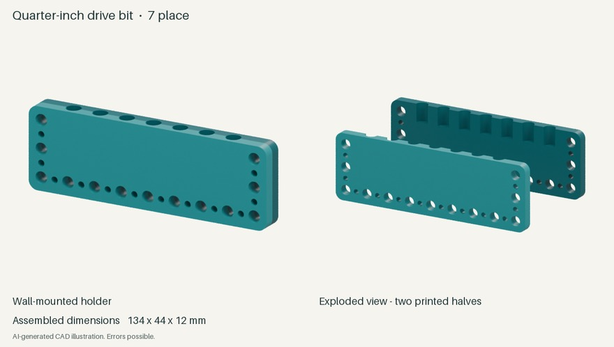

<!-- oomp-tools:start -->
# Quarter-inch drive bit

[Tool catalogue](../../README.md) / [screwdriver bit](../../navigation_oomp/tool/screwdriver_bit/README.md)

`tool_screwdriver_bit_quarter_inch_drive`

**Holder clearance profile.** Geometry follows the holder clearance profile. Its dimensions describe the pocket used in the source design. Physical tool dimensions and fit have yet to be measured.

The drive size is 6.35 mm. The holder uses a round 8 × 100 mm clearance profile for bits with unspecified length and head.

## Model files

[OpenSCAD](three_d_model/working.scad) · [STL · mm](three_d_model/working.stl) · [glTF · metres](three_d_model/working.glb) · [OOMP record](working.yaml)

## Drawings and views

[Dimension drawing](working.svg)

## Sourcing and documentation

- Original vertical holder tool selection and pocket dimensions. [OOBB vertical holder recipe](https://github.com/oomlout/oomlout_oobb_part_tool_holder_vertical/blob/93a962a09e0c275c3cfa62187182ac3203bde1b2/scad.py)

## Holder layouts

| Layout | Places for this tool |
| --- | ---: |
| [driver bit quarter inch 7 place 9x3x12](../../HOLDERS.md#oobb_part_holder_tool_driver_bit_quarter_inch_7_place_9x3x12) | 7 |
| [driver bit quarter inch 7 place 9x4x12](../../HOLDERS.md#oobb_part_holder_tool_driver_bit_quarter_inch_7_place_9x4x12) | 7 |
| [driver bit quarter inch 8 place 9x3x12](../../HOLDERS.md#oobb_part_holder_tool_driver_bit_quarter_inch_8_place_9x3x12) | 8 |
| [driver bit quarter inch 8 place 9x4x12](../../HOLDERS.md#oobb_part_holder_tool_driver_bit_quarter_inch_8_place_9x4x12) | 8 |
| [driver bit quarter inch 8 plus 7 layered 9x3x12](../../HOLDERS.md#oobb_part_holder_tool_driver_bit_quarter_inch_8_plus_7_layered_9x3x12) | 15 |
| [driver bit quarter inch 8 plus 7 layered 9x4x12](../../HOLDERS.md#oobb_part_holder_tool_driver_bit_quarter_inch_8_plus_7_layered_9x4x12) | 15 |

Holder preview from [OOBB part holder v5](../../HOLDERS.md#oobb_part_holder_tool_driver_bit_quarter_inch_7_place_9x3x12).
<!-- oomp-tools:end -->
