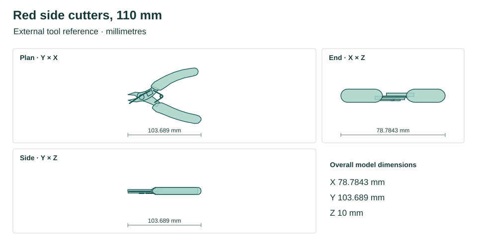
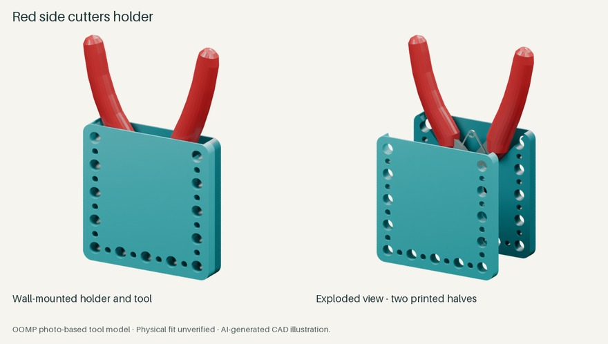

<!-- oomp-tools:start -->
# Red side cutters, 110 mm

[Tool catalogue](../../README.md) / [side cutters](../../navigation_oomp/tool/side_cutters/README.md)

`tool_side_cutters_110_mm_length_red`

**Photo-based tool model.** Open-pose photo trace with a provisional 110 mm closed-length reference (Rapid SA-706 RED). Grip thickness is estimated.

## Photograph and measurements

[Workshop photograph](PXL_20261119_134714181.jpg) · [Measurements and assumptions](measurements.md) · [Photo with model outline](photo_overlay.svg) · [Identification research (2026-11-19)](research_2026-11-19.md)

## Model files

[OpenSCAD](three_d_model/working.scad) · [STL · mm](three_d_model/working.stl) · [glTF · metres](three_d_model/working.glb) · [Blender scene](three_d_model/working.blend) · [OOMP record](working.yaml)

## Drawings and views

[Studio render](three_d_model/render.png) · [Top render](three_d_model/render_top.png) · [Dimension drawing](working.svg) · [Holder clearance drawing](holder_profile.svg)

## Sourcing and documentation

- Upstream tool naming and clearance geometry used in the holder migration. [OOBB v4 tool shapes](https://github.com/oomlout/oomlout_oobb_version_4/blob/41f5386997faef4473c959dfb8c929864d7bf697/oobb_get_items_base_old.py)

## Holder layouts

| Layout | Places for this tool |
| --- | ---: |
| [mixed tools basic stand bench 7x10x66](../../HOLDERS.md#oobb_part_holder_tool_mixed_tools_basic_stand_bench_7x10x66) | 1 |
| [side cutters generic 110mm 1 place 5x5x13](../../HOLDERS.md#oobb_part_holder_tool_side_cutters_generic_110mm_1_place_5x5x13) | 1 |

Holder preview from [OOBB part holder v5](https://github.com/oomlout/oomlout_oobb_part_holder_tool_version_5/blob/main/parts/oobb_part_holder_tool_side_cutters_generic_110mm_1_place_5x5x13/README.md#assembly).

[Holder README and assembly instructions](https://github.com/oomlout/oomlout_oobb_part_holder_tool_version_5/blob/main/parts/oobb_part_holder_tool_side_cutters_generic_110mm_1_place_5x5x13/README.md#assembly) · [Print booklet (PDF)](../../source_file/tool_references/holders/oobb_part_holder_tool_side_cutters_generic_110mm_1_place_5x5x13.pdf)
<!-- oomp-tools:end -->
