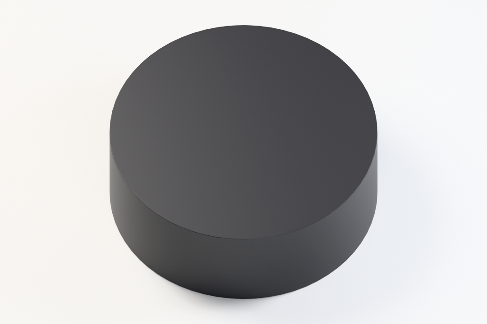
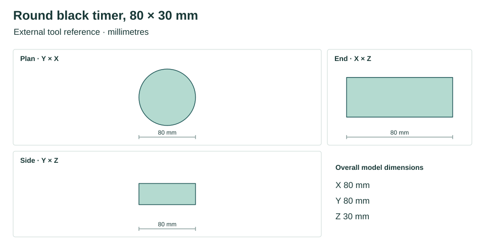
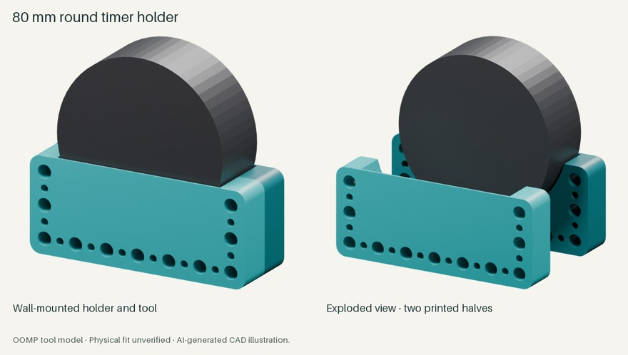

<!-- oomp-tools:start -->
# Round black timer, 80 × 30 mm

[Tool catalogue](../../README.md) / [timer](../../navigation_oomp/tool/timer/README.md)

`tool_timer_80_mm_diameter_30_mm_depth_black`

**External tool reference.** External body envelope from the OOMP timer record. The holder has clearance around both faces and the rim.

## Model files

[OpenSCAD](three_d_model/working.scad) · [STL · mm](three_d_model/working.stl) · [glTF · metres](three_d_model/working.glb) · [Blender scene](three_d_model/working.blend) · [OOMP record](working.yaml)

## Drawings and views

[Studio render](three_d_model/render.png) · [Top render](three_d_model/render_top.png) · [Dimension drawing](working.svg) · [Holder clearance drawing](holder_profile.svg)

## Sourcing and documentation

- Upstream tool naming and clearance geometry used in the holder migration. [OOBB v4 tool shapes](https://github.com/oomlout/oomlout_oobb_version_4/blob/41f5386997faef4473c959dfb8c929864d7bf697/oobb_get_items_base_old.py)
- Legacy taxonomy, identity and archived sourcing fields. [Archived OOMP part](https://github.com/oomlout/oomlout_oomp_version_1_messy/tree/main/parts/tool_timer_80_mm_diameter_30_mm_depth_black)
- Archived distributor reference [Amazon UK B07VNWZCZH](https://www.amazon.co.uk/gp/product/B07VNWZCZH).

## Holder layouts

| Layout | Places for this tool |
| --- | ---: |
| [timer round 80mm 1 place 7x3x34](../../HOLDERS.md#oobb_part_holder_tool_timer_round_80mm_1_place_7x3x34) | 1 |

Holder preview from [OOBB part holder v5](https://github.com/oomlout/oomlout_oobb_part_holder_tool_version_5/blob/main/parts/oobb_part_holder_tool_timer_round_80mm_1_place_7x3x34/README.md#assembly).

[Holder README and assembly instructions](https://github.com/oomlout/oomlout_oobb_part_holder_tool_version_5/blob/main/parts/oobb_part_holder_tool_timer_round_80mm_1_place_7x3x34/README.md#assembly) · [Print booklet (PDF)](../../source_file/tool_references/holders/oobb_part_holder_tool_timer_round_80mm_1_place_7x3x34.pdf)
<!-- oomp-tools:end -->
