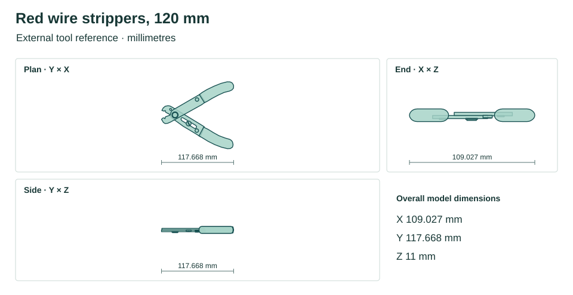
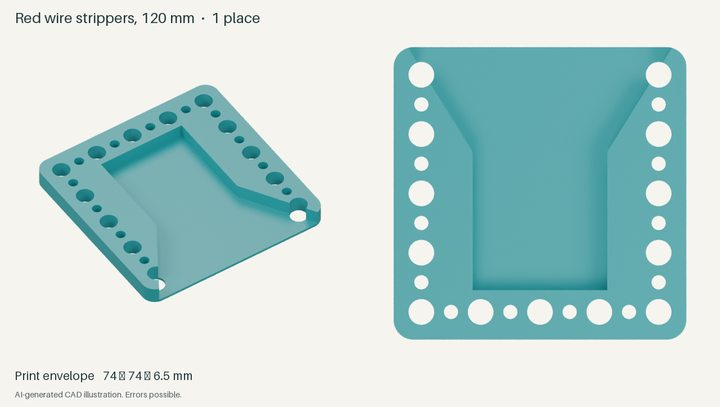

<!-- oomp-tools:start -->
# Red wire strippers, 120 mm

`tool_wire_strippers_120_mm_length_red`

**Holder clearance profile.** Geometry follows the holder clearance profile. Its dimensions describe the pocket used in the source design. Physical tool dimensions and fit have yet to be measured.

[Dimension drawing](working.svg) · [OpenSCAD](three_d_model/working.scad) · [STL · mm](three_d_model/working.stl) · [glTF · metres](three_d_model/working.glb) · [OOMP record](working.yaml)

## Sourcing and documentation

- Upstream tool naming and clearance geometry used in the holder migration. [OOBB v4 tool shapes](https://github.com/oomlout/oomlout_oobb_version_4/blob/41f5386997faef4473c959dfb8c929864d7bf697/oobb_get_items_base_old.py)

## Holder layouts

| Layout | Places for this tool |
| --- | ---: |
| [mixed tools basic stand bench 7x10x66](../../HOLDERS.md#oobb_part_holder_tool_mixed_tools_basic_stand_bench_7x10x66) | 1 |
| [wire strippers generic 120mm 1 place 5x5x13](../../HOLDERS.md#oobb_part_holder_tool_wire_strippers_generic_120mm_1_place_5x5x13) | 1 |

Holder preview from [OOBB part holder v5](../../HOLDERS.md#oobb_part_holder_tool_wire_strippers_generic_120mm_1_place_5x5x13).
<!-- oomp-tools:end -->
