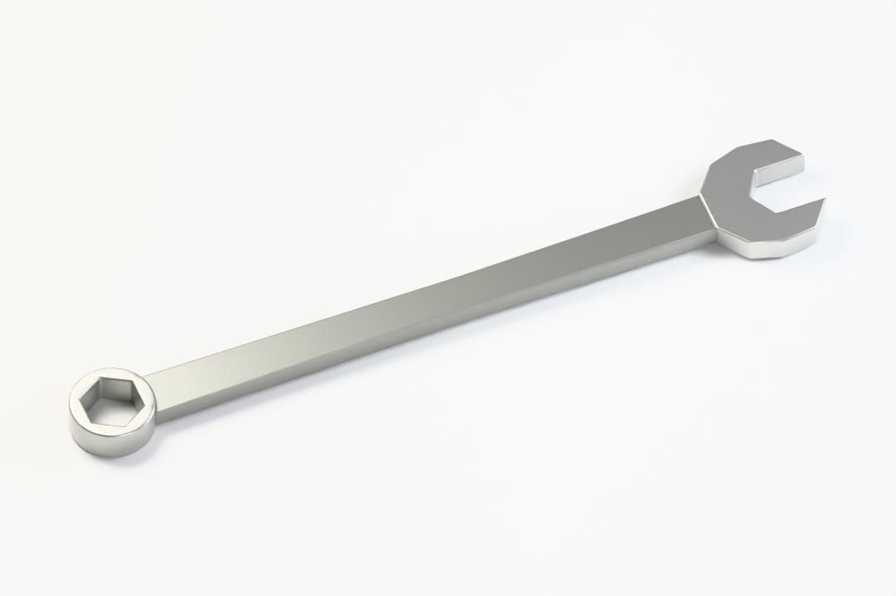
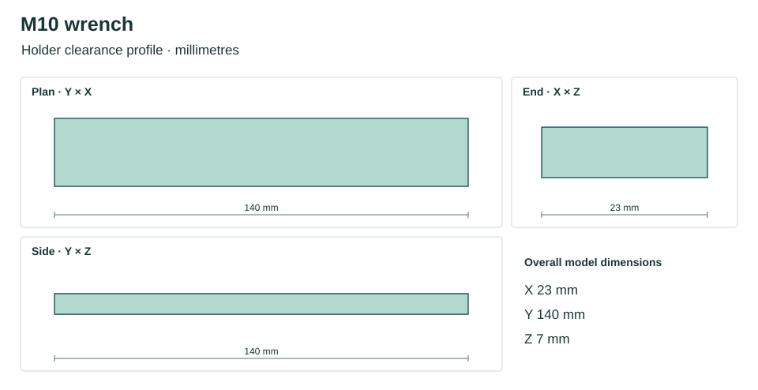
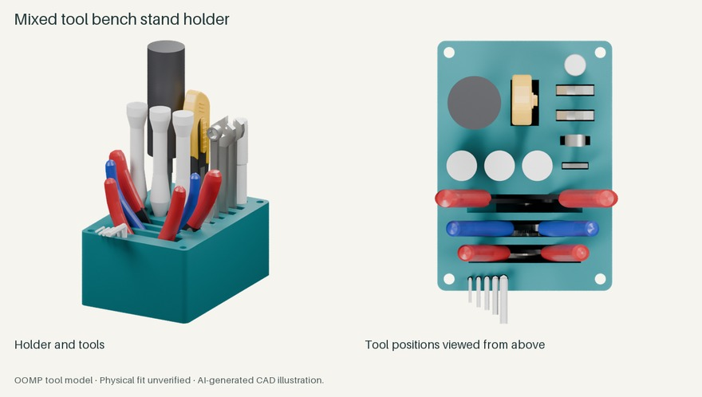

<!-- oomp-tools:start -->
# M10 spanner

[Tool catalogue](../../README.md) / [wrench](../../navigation_oomp/tool/wrench/README.md)

`tool_wrench_m10`

**External tool reference.** Generic 10 mm combination spanner using the Bahco 111M-10 as a dimensional reference. Length and head widths and thicknesses follow the catalogue. The straight shank, jaw outline and six-point ring are simplified. The workshop specimen has not been measured.

## Model files

[OpenSCAD](three_d_model/working.scad) · [STL · mm](three_d_model/working.stl) · [glTF · metres](three_d_model/working.glb) · [Blender scene](three_d_model/working.blend) · [OOMP record](working.yaml)

## Drawings and views

[Studio render](three_d_model/render.png) · [Top render](three_d_model/render_top.png) · [Dimension drawing](working.svg) · [Holder clearance drawing](holder_profile.svg)

## Sourcing and documentation

- 111M-10 across-flats size, length, two head widths and two head thicknesses. [Bahco 111M metric flat combination spanners](https://www.bahco.com/int_en/metric-flat-combination-wrenches-with-chrome-finish-pb_111m_.html)
- Upstream tool naming and clearance geometry used in the holder migration. [OOBB v4 tool shapes](https://github.com/oomlout/oomlout_oobb_version_4/blob/41f5386997faef4473c959dfb8c929864d7bf697/oobb_get_items_base_old.py)

## Holder layouts

| Layout | Places for this tool |
| --- | ---: |
| [mixed tools basic stand bench 7x10x66](../../HOLDERS.md#oobb_part_holder_tool_mixed_tools_basic_stand_bench_7x10x66) | 2 |
| [spanner m10 1 place 3x5x9](../../HOLDERS.md#oobb_part_holder_tool_spanner_m10_1_place_3x5x9) | 1 |
| [spanner m10 2 place 5x5x9](../../HOLDERS.md#oobb_part_holder_tool_spanner_m10_2_place_5x5x9) | 2 |
| [spanner m10 3 place 7x5x9](../../HOLDERS.md#oobb_part_holder_tool_spanner_m10_3_place_7x5x9) | 3 |
| [spanner m10 4 place 9x5x9](../../HOLDERS.md#oobb_part_holder_tool_spanner_m10_4_place_9x5x9) | 4 |
| [spanner m13 m10 m8 m7 4 place 9x5x10](../../HOLDERS.md#oobb_part_holder_tool_spanner_m13_m10_m8_m7_4_place_9x5x10) | 1 |

Holder preview from [OOBB part holder v5](https://github.com/oomlout/oomlout_oobb_part_holder_tool_version_5/blob/main/parts/oobb_part_holder_tool_mixed_tools_basic_stand_bench_7x10x66/README.md#assembly).

[Holder README and assembly instructions](https://github.com/oomlout/oomlout_oobb_part_holder_tool_version_5/blob/main/parts/oobb_part_holder_tool_mixed_tools_basic_stand_bench_7x10x66/README.md#assembly) · [Print booklet (PDF)](../../source_file/tool_references/holders/oobb_part_holder_tool_mixed_tools_basic_stand_bench_7x10x66.pdf)
<!-- oomp-tools:end -->
