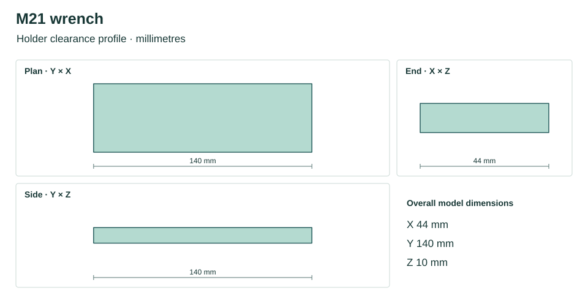
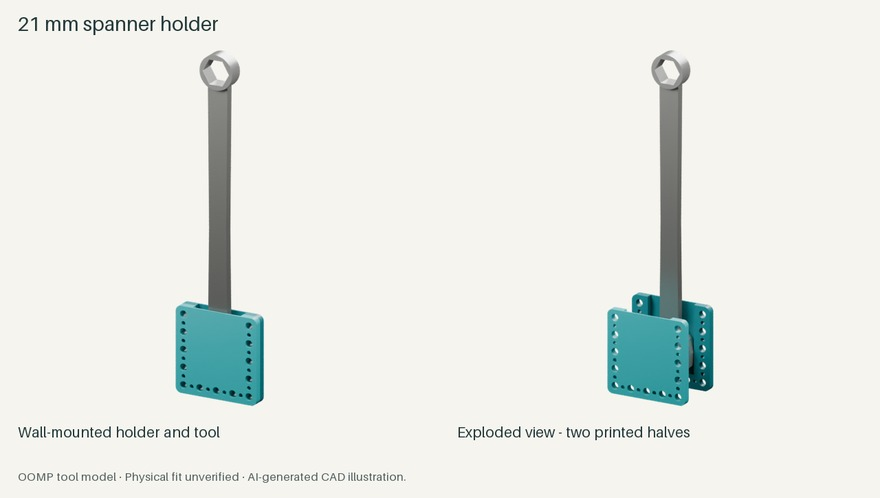

<!-- oomp-tools:start -->
# M21 spanner

[Tool catalogue](../../README.md) / [wrench](../../navigation_oomp/tool/wrench/README.md)

`tool_wrench_m21`

**External tool reference.** Generic 21 mm combination spanner using Stahlwille OPEN BOX 14 article 40102121 as a dimensional reference. Length and both head widths and thicknesses follow the catalogue. The straight body, head outlines and ring offset are simplified. The workshop specimen has not been measured.

## Model files

[OpenSCAD](three_d_model/working.scad) · [STL · mm](three_d_model/working.stl) · [glTF · metres](three_d_model/working.glb) · [Blender scene](three_d_model/working.blend) · [OOMP record](working.yaml)

## Drawings and views

[Studio render](three_d_model/render.png) · [Top render](three_d_model/render_top.png) · [Dimension drawing](working.svg) · [Holder clearance drawing](holder_profile.svg)

## Sourcing and documentation

- 21 mm jaw, 280 mm length, 43 mm open head width, 29.8 mm ring width, and 8.5 mm and 13 mm head thicknesses. [Stahlwille OPEN BOX 14 article 40102121](https://stahlwille.com/en_gb/products/detail/874650)
- Upstream tool naming and clearance geometry used in the holder migration. [OOBB v4 tool shapes](https://github.com/oomlout/oomlout_oobb_version_4/blob/41f5386997faef4473c959dfb8c929864d7bf697/oobb_get_items_base_old.py)

## Holder layouts

| Layout | Places for this tool |
| --- | ---: |
| [spanner m21 1 place 5x5x12](../../HOLDERS.md#oobb_part_holder_tool_spanner_m21_1_place_5x5x12) | 1 |

Holder preview from [OOBB part holder v5](https://github.com/oomlout/oomlout_oobb_part_holder_tool_version_5/blob/main/parts/oobb_part_holder_tool_spanner_m21_1_place_5x5x12/README.md#assembly).

[Holder README and assembly instructions](https://github.com/oomlout/oomlout_oobb_part_holder_tool_version_5/blob/main/parts/oobb_part_holder_tool_spanner_m21_1_place_5x5x12/README.md#assembly) · [Print booklet (PDF)](../../source_file/tool_references/holders/oobb_part_holder_tool_spanner_m21_1_place_5x5x12.pdf)
<!-- oomp-tools:end -->
