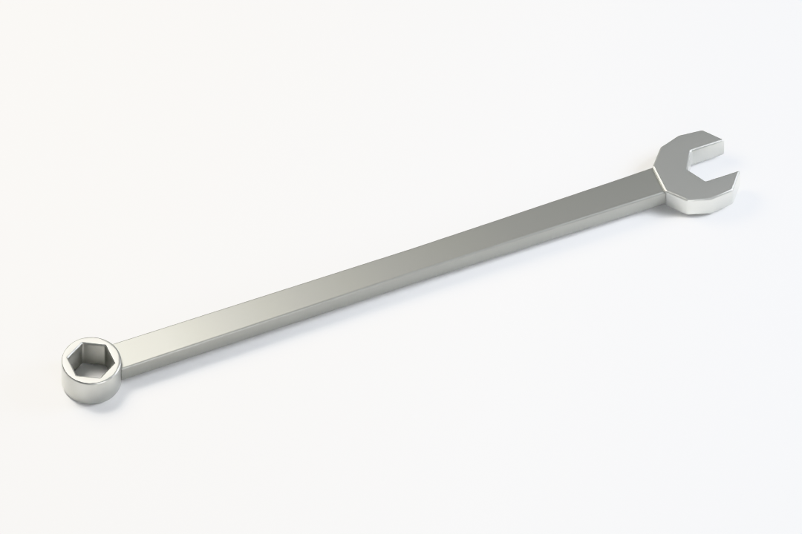
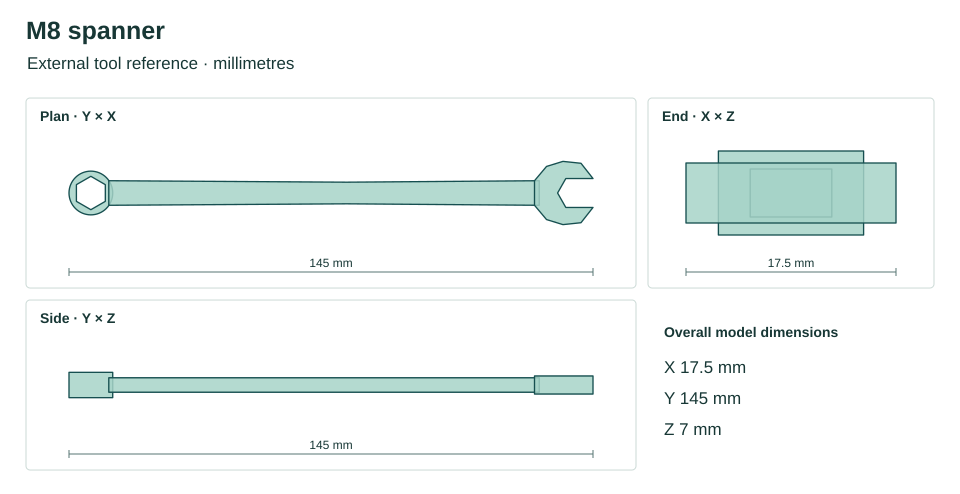
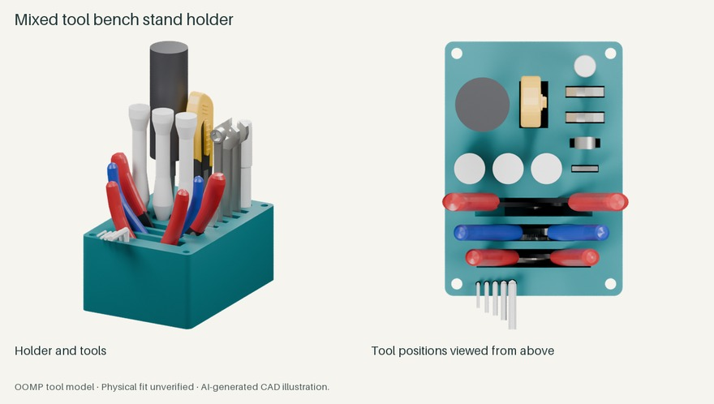

<!-- oomp-tools:start -->
# M8 spanner

[Tool catalogue](../../README.md) / [wrench](../../navigation_oomp/tool/wrench/README.md)

`tool_wrench_m8`

**External tool reference.** Generic 8 mm combination spanner using Stahlwille OPEN BOX 14 article 40100808 as a dimensional reference. Length and both head widths and thicknesses follow the catalogue. The straight body, head outlines and ring offset are simplified. The workshop specimen has not been measured.

## Model files

[OpenSCAD](three_d_model/working.scad) · [STL · mm](three_d_model/working.stl) · [glTF · metres](three_d_model/working.glb) · [Blender scene](three_d_model/working.blend) · [OOMP record](working.yaml)

## Drawings and views

[Studio render](three_d_model/render.png) · [Top render](three_d_model/render_top.png) · [Dimension drawing](working.svg) · [Holder clearance drawing](holder_profile.svg)

## Sourcing and documentation

- 8 mm jaw, 145 mm length, 17.5 mm open head width, 12.1 mm ring width, and 5 mm and 7 mm head thicknesses. [Stahlwille OPEN BOX 14 article 40100808](https://stahlwille.com/en_gb/products/detail/874570)
- Alternative FACOM 34.8 has an 18.5 mm head, wider than the 18 mm single-holder pocket. [FACOM 34 metric open-end spanners](https://facom.eu/products/34-midget-double-open-end-wrenches-metric)
- Upstream tool naming and clearance geometry used in the holder migration. [OOBB v4 tool shapes](https://github.com/oomlout/oomlout_oobb_version_4/blob/41f5386997faef4473c959dfb8c929864d7bf697/oobb_get_items_base_old.py)

## Holder layouts

| Layout | Places for this tool |
| --- | ---: |
| [mixed tools basic stand bench 7x10x66](../../HOLDERS.md#oobb_part_holder_tool_mixed_tools_basic_stand_bench_7x10x66) | 1 |
| [spanner m13 m10 m8 m7 4 place 9x5x10](../../HOLDERS.md#oobb_part_holder_tool_spanner_m13_m10_m8_m7_4_place_9x5x10) | 1 |
| [spanner m8 1 place 3x5x7d5](../../HOLDERS.md#oobb_part_holder_tool_spanner_m8_1_place_3x5x7d5) | 1 |

Holder preview from [OOBB part holder v5](https://github.com/oomlout/oomlout_oobb_part_holder_tool_version_5/blob/main/parts/oobb_part_holder_tool_mixed_tools_basic_stand_bench_7x10x66/README.md#assembly).

[Holder README and assembly instructions](https://github.com/oomlout/oomlout_oobb_part_holder_tool_version_5/blob/main/parts/oobb_part_holder_tool_mixed_tools_basic_stand_bench_7x10x66/README.md#assembly) · [Print booklet (PDF)](../../source_file/tool_references/holders/oobb_part_holder_tool_mixed_tools_basic_stand_bench_7x10x66.pdf)
<!-- oomp-tools:end -->
